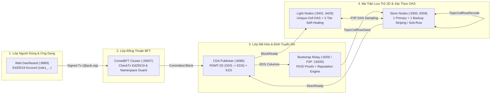

# CDA Network — Hướng Dẫn Thiết Lập, Tham Gia & Sử Dụng Hệ Thống Toàn Diện

**CDA Network** là lớp Khả dụng Dữ liệu (Data Availability - DA) thông lượng cao, độ trễ thấp, kết hợp **Mã hóa Mạng Tuyến tính Ngẫu nhiên (RLNC)**, **Cây Merkle Reed-Solomon 2 Chiều (RSMT-2D)**, **Cam kết Đa thức KZG (BLS12-381 / FK20)** và **Đồng thuận CometBFT**.

Tài liệu này hướng dẫn trọn vẹn 3 quy trình cốt lõi của hệ thống:
1. **[Phần 1: Khởi tạo Cụm Mạng Cốt Lõi (Network Initialization)](#phần-1-khởi-tạo-cụm-mạng-cốt-lõi-network-initialization)**
2. **[Phần 2: Tham Gia Mạng làm Store Node / Light Node & Hệ Thống Điểm Tín Nhiệm (Node Onboarding & Reputation)](#phần-2-tham-gia-mạng-làm-store-node--light-node--hệ-thống-điểm-tín-nhiệm)**
3. **[Phần 3: Người Dùng Tạo Tài Khoản, Ký Giao Dịch & Lưu Trữ Dữ Liệu (User & Application Flow)](#phần-3-người-dùng-tạo-tài-khoản-ký-giao-dịch--lưu-trữ-dữ-liệu)**

> 📖 Xem thêm chi tiết kỹ thuật chuyên sâu tại **[Hướng Dẫn Vận Hành Hệ Thống (`docs/OPERATIONS_GUIDE.md`)](file:///home/ubuntu/cda-network/docs/OPERATIONS_GUIDE.md)** và **[Từ Điển Thuật Ngữ (`GLOSSARY.md`)](file:///home/ubuntu/cda-network/GLOSSARY.md)**.

---

## Kiến Trúc Tổng Quan



---

## Phần 1: Khởi Tạo Cụm Mạng Cốt Lõi (Network Initialization)

Quá trình khởi tạo mạng thiết lập cụm **CometBFT Validators**, **CDA Publisher Node**, **Bootstrap Node (Column Relay)**, các **Store Nodes** ban đầu và **Web Dashboard**.

### 1.1. Biên dịch các Binary thực thi (Nếu chạy trực tiếp hoặc phát triển)

```bash
mkdir -p bin
go build -o bin/publisher ./cda-publisher-node/cmd/publisher/main.go
go build -o bin/bootstrap ./cda-bootstrap-node/cmd/bootstrap/main.go
go build -o bin/store     ./cda-store-node/cmd/store/main.go
go build -o bin/light     ./cda-light-node/cmd/light/main.go
```

### 1.2. Khởi tạo Cụm Mạng bằng Docker Compose (Cấu hình Chuẩn 2 Máy: `active-cols = 1`, `net-rows = 4`, 6 Store Nodes Máy Chính + 2 Store Nodes Máy Phụ)

Với mô hình **1 Máy Chính + 1 Máy Phụ**, cấu hình tối ưu nhất là **`active_cols = 1` với `4 row mạng (Row 0..3)`** và tổng cộng **8 Store Nodes ($M = 2$ Store Nodes / mỗi ô mạng)**:
- **Trên Máy Chính (Main Server)**: Chạy `CometBFT (4 Validators)` + `Publisher (:8080)` + `Bootstrap-0 (:9200)` + **6 Store Nodes (`:9300..9305`)** + `1 Light Node (:9401)`.
  - 6 Store Nodes trên Máy Chính được phân bổ xoay vòng vào 4 hàng mạng:
    - `Cell [Row 0, Col 0]`: **2 Store Nodes** (`store-0-1 :9300`, `store-0-5 :9304`) $\implies$ Đủ $M = 2$ node bản địa.
    - `Cell [Row 1, Col 0]`: **2 Store Nodes** (`store-0-2 :9301`, `store-0-6 :9305`) $\implies$ Đủ $M = 2$ node bản địa.
    - `Cell [Row 2, Col 0]`: **1 Store Node** (`store-0-3 :9302`) $\implies$ Khi Máy Phụ chưa bật, tự động mượn 1 Backup từ `Row 0/1`.
    - `Cell [Row 3, Col 0]`: **1 Store Node** (`store-0-4 :9303`) $\implies$ Khi Máy Phụ chưa bật, tự động mượn 1 Backup từ `Row 0/1`.
- **Trên Máy Phụ (Worker Server)**: Chạy **2 Store Nodes (`:9310`, `:9311`)** + `1 Light Node (:9410)` qua [`docker-compose.worker.yml`](file:///home/ubuntu/cda-network/docker-compose.worker.yml):
  - Ngay khi Máy Phụ khởi chạy ở chế độ Auto-Join (`STORE_ROW=-1`), thuật toán `Least-Loaded Cell Discovery` phát hiện `Row 2` và `Row 3` mới có 1 node nên tự động xếp **2 Store Nodes của Máy Phụ vào `Row 2` và `Row 3`**, hoàn thiện ma trận đối xứng **$4 \text{ hàng} \times 2 \text{ nodes/ô} = 8 \text{ Store Nodes}$** xuyên 2 máy vật lý!

#### Bước khởi chạy trên Máy Chính (ví dụ IP `192.168.1.10`):
```bash
# Bước 1: Dọn dẹp container và dữ liệu cũ (nếu muốn khởi tạo lại từ Genesis)
bash scripts/cleanup.sh

# Bước 2: Sinh khóa cho 4 CometBFT Validators và cấu hình RPC max_body_bytes = 10MB
python3 scripts/init_cometbft_cluster.py --validators 4

# Bước 3: Sinh cấu hình active-cols=1 (-c 1), 4 hàng mạng (-s 4), 6 Store Nodes (--total-stores 6), 1 Light Node (-l 1)
python3 scripts/generate_compose.py -c 1 -s 4 --total-stores 6 -l 1 -k 64

# Bước 4: Khởi chạy cụm trên Máy Chính (truyền MAIN_HOST_IP để 6 Store Nodes quảng bá IP LAN cho Máy Phụ kết nối P2P)
MAIN_HOST_IP=192.168.1.10 docker compose -f docker-compose.json up -d --build
```

*(Tùy chọn: Nếu muốn Máy Chính chỉ chạy thuần `CometBFT + Publisher + Bootstrap` không có Store Node nào, dùng `docker compose -f docker-compose.core.yml up -d --build` hoặc `python3 scripts/generate_compose.py --core-only -c 1 -s 4 -k 64`).*

### 1.3. Khởi chạy Giao diện Theo dõi & Proxy Server (`:8889`)

```bash
python3 -u scripts/serve_dashboard.py 8889
```

Sau khi khởi chạy, hệ thống cung cấp 2 giao diện Web tách biệt:
- **Giao diện Người dùng & Theo dõi Ma trận (Chỉ đọc)**: `http://<server-ip>:8889/` (hoặc `/dashboard`)
- **Giao diện Quản trị Mạng & Vận hành Node**: `http://<server-ip>:8889/network-admin`

### 1.4. Kiểm tra trạng thái cụm mạng sau khi khởi tạo

```bash
# Kiểm tra ma trận mạng 2D, danh sách Store Nodes, Light Nodes và Điểm Tín nhiệm
./scripts/cda_node_ctl.sh status

# Kiểm tra bảng xếp hạng Điểm Tín nhiệm Node
./scripts/cda_node_ctl.sh rep-status
```

---

## Phần 2: Tham Gia Mạng làm Store Node / Light Node & Hệ Thống Điểm Tín Nhiệm

Một nút mới có thể tham gia mạng CDA dưới vai trò **Store Node** (lưu trữ mảnh RLNC, tái mã hóa và bảo chứng dữ liệu) hoặc **Light Node** (lấy mẫu kiểm chứng khả dụng dữ liệu DAS).

### 2.1. Cách 1 — Tham gia mạng từ một Máy Chủ Khác qua Docker (`Multi-Host Docker`)

Khi cụm chính đang chạy ở **Máy Chính (ví dụ IP `192.168.1.10`)** và bạn muốn đưa Docker sang **Máy Phụ (ví dụ IP `192.168.1.50`)** để tham gia mạng:

#### A. Đóng gói Docker Image mang sang Máy Phụ (hoặc build trực tiếp từ source)
```bash
# Trên Máy Chính: đóng gói image ra file .tar (nếu Máy Phụ không có sẵn mã nguồn)
docker build -t cda-node:latest -f Dockerfile .
docker save -o cda-node.tar cda-node:latest

# Trên Máy Phụ (192.168.1.50): nạp image
docker load -i cda-node.tar
```

#### B. Khởi chạy 2 Store Nodes & 1 Light Node trên Máy Phụ bằng [`docker-compose.worker.yml`](file:///home/ubuntu/cda-network/docker-compose.worker.yml)
```bash
# Trên Máy Phụ (192.168.1.50): khởi chạy 2 Store Nodes (:9310, :9311) + 1 Light Node (:9410)
# Hai Store Nodes này sẽ tự động phát hiện Row 2 và Row 3 trên Máy Chính đang chỉ có 1 node (Least-Loaded)
# và gia nhập vào Row 2 & Row 3 để hoàn thiện ma trận 4 hàng x 2 nodes/ô = 8 Store Nodes!
MAIN_HOST_IP=192.168.1.10 \
WORKER_PUBLIC_IP=192.168.1.50 \
CDA_NET_ROWS=4 \
docker compose -f docker-compose.worker.yml up -d --build
```

- **Chế độ Auto-Join (`STORE_ROW=-1`)**: Store Node mới tự động truy vấn `/bootstrap/peers` trên Máy Chính, tìm **ô mạng đang có ít Store Node nhất (`Least-Loaded Cell`)**, sinh khóa định danh P2P tương ứng, đăng ký địa chỉ `/ip4/192.168.1.50/udp/19310/quic-v1` và tự động kéo dữ liệu các block gần nhất (`Catch-Up`).
- **Chế độ Chỉ định Ô (`STORE_ROW=0..7`)**: Đưa node vào một ô cụ thể để tăng số lượng node trong ô lên $M \ge 2$, tự động kích hoạt chế độ **Chia tải `1 Primary + 1 Backup` theo từng `(blockID, subRow)`**.

#### C. Hoặc chạy trực tiếp bằng lệnh `docker run` đơn lẻ trên Máy Phụ
```bash
# 1. Tham gia làm Store Node (Auto-Join):
docker run -d --name cda-worker-store \
  -p 9310:9310 -p 19310:19310/tcp -p 19310:19310/udp \
  cda-node:latest /usr/local/bin/store \
  -port 9310 -row -1 -col 0 \
  -publisher http://192.168.1.10:8080 \
  -bootstrap http://192.168.1.10:9200 \
  -myaddr http://192.168.1.50:9310 \
  -k 64 -k-piece 4 -num-cols 8 -stores-per-col 8

# 2. Tham gia làm Light Node (Auto-DAS):
docker run -d --name cda-worker-light \
  -p 9410:9410 -p 19410:19410/tcp -p 19410:19410/udp \
  cda-node:latest /usr/local/bin/light \
  -port 9410 \
  -publisher http://192.168.1.10:8080 \
  -bootstraps "0:http://192.168.1.10:9200" \
  -k 64 -k-piece 4 -num-cols 8 -auto-das=true
```

---

### 2.2. Cách 2 — Quản lý Join / Leave & Chạy DAS bằng Script CLI ([`scripts/cda_node_ctl.sh`](file:///home/ubuntu/cda-network/scripts/cda_node_ctl.sh))

```bash
# 1. Cho 1 Store Node mới gia nhập mạng (tự động vào ô ít tải nhất hoặc chỉ định hàng 0..7)
./scripts/cda_node_ctl.sh join-store auto
./scripts/cda_node_ctl.sh join-store 0

# 2. Cho Store Node rời mạng chủ động (Graceful Leave qua SIGTERM -> tái cân bằng Custody tức thì)
./scripts/cda_node_ctl.sh leave-store 9310

# 3. Cho 1 Light Node mới gia nhập hoặc rời mạng
./scripts/cda_node_ctl.sh join-light
./scripts/cda_node_ctl.sh leave-light 9402

# 4. Thực thi lấy mẫu DAS từ Light Node (ngẫu nhiên N ô không trùng hoặc chỉ định 1 ô [row, col])
./scripts/cda_node_ctl.sh das 5 4
./scripts/cda_node_ctl.sh das-cell 5 0 0
```

---

### 2.3. Cơ chế Chia Tải Đa Node trong 1 Ô ($M \ge 2$) & Điểm Tín Nhiệm Node

1. **Chia tải động theo Hàng dữ liệu con & Xoay vòng theo Block (`Per-SubRow & Per-Block Custody Striping`)**:
   - Với block chuẩn $K = 64 \implies N = 128$ hàng dữ liệu và $R_{\text{net}} = 8$ hàng mạng, mỗi ô mạng `[Row r, Col c]` quản lý **16 hàng dữ liệu con** (`subRow = 0..15`, ứng với `dataRow = r, r+8, ..., r+120`).
   - Khi một ô mạng có $M \ge 2$ Store Nodes, hệ thống **không bắt cả $M$ node lưu trùng lặp cả 16 hàng**, mà chọn tất định đúng **`1 Primary Custody` (lưu đủ 4 mảnh gốc) + `1 Backup Custody` (hỗ trợ recode rồi cắt gọn về 1 mảnh)** cho từng `(blockID, subRow)` theo công thức:
     $$\text{idx}_{\text{primary}} = \left(\text{FNV1a}(\text{blockID}, r_{\text{net}}) + \text{subRow}\right) \bmod M_{\text{healthy}}$$
   - Các node còn lại trong ô đóng vai trò **Non-Custody** (bỏ qua `/seed`, chỉ nhận `/recode` và giữ 1 mảnh), giúp giảm tải CPU xác thực KZG, băng thông Gossip và dung lượng đĩa theo tỷ lệ $1/M$.
2. **Hệ thống Điểm Tín nhiệm Chống Tranh chấp Tài nguyên (`Contention-Safe Reputation System`)**:
   - Mỗi node khởi đầu ở mức **`60.0` (`STANDARD`)**.
   - **Thưởng**: Hoàn thành `StoreReady` cho block (**`+2.0`**), phục vụ truy vấn DAS (**`+0.5`**).
   - **Tha thứ Node Chậm (`Straggler Forgiveness`)**: Nếu chạy nhiều node trên cùng 1 máy khiến một node hoàn thành `StoreReady` trễ sau thời điểm `2/3 BlockReady`, ngay khi báo cáo đến nơi hệ thống tự động xóa lỗi trễ hạn và cộng thưởng `+2.0` bình thường.
   - **4 Phân hạng Tín nhiệm**:
     - **`TRUSTED` ($75.0 - 100.0$)**: Ưu tiên chọn làm Primary Custody, ưu tiên mượn làm Borrowed Backup và ưu tiên truy vấn DAS.
     - **`STANDARD` ($40.0 - 74.9$)**: Đủ điều kiện tham gia đầy đủ vòng xoay `(1 Primary + 1 Backup)`.
     - **`PROBATION` ($20.0 - 39.9$, sàn bảo vệ lỗi mềm `25.0`)**: Mọi lỗi mềm (`missed_block: -8.0`, `fetch_timeout: -3.0`, `ungraceful_drop: -10.0`) không bao giờ làm node bị abort hay rơi xuống dưới `25.0`. Khi ở `PROBATION`, nếu ô có node khỏe mạnh khác thì node `PROBATION` chuyển sang làm Backup/Non-Custody nhẹ tải; nếu ô chỉ có 1 node duy nhất thì hệ thống tự nâng node Backup mượn từ hàng khác lên làm **`Co-Primary Guardian` (giữ song song 4 mảnh gốc)** trong lúc node `PROBATION` tiếp tục hoàn thành block để tự hồi phục điểm (`Self-Healing`) lên lại $\ge 40.0$.
     - **`QUARANTINED` ($0.0$)**: Chỉ áp dụng khi có bằng chứng gian lận mật mã KZG (`ByzantineNodeReport`) hoặc báo cáo vu khống (`Griefing`), lập tức cô lập node khỏi bảng định tuyến.

```bash
# Kiểm thử tự động toàn bộ 4 kịch bản Điểm Tín nhiệm & Chống tranh chấp CPU:
python3 scripts/tests/resilience/test_reputation_system.py
```

---

## Phần 3: Người Dùng Tạo Tài Khoản, Ký Giao Dịch & Lưu Trữ Dữ Liệu

Người dùng cuối và các ứng dụng L2 tương tác với CDA Network thông qua **Web Dashboard (`http://localhost:8889/`)** hoặc trực tiếp qua **CometBFT JSON-RPC (`:26657`)** và **Publisher REST API (`:8080`)**.

### 3.1. Tạo / Quản lý Tài khoản Ed25519 & Quyền Sở hữu Namespace

1. Mở giao diện **`http://localhost:8889/`** (Tab **`Account & Keys`** hoặc thanh trạng thái trên cùng):
   - Trình duyệt tự động sinh cặp khóa **RFC 8032 Ed25519** cục bộ (Private Key không bao giờ rời khỏi trình duyệt) và suy diễn địa chỉ tài khoản theo chuẩn:
     $$\text{Address} = \texttt{cda1\_} \parallel \text{Hex}(\text{SHA256}(\text{PubKey}))[0..16]$$
   - Hỗ trợ **Generate New Keypair**, **Export Keypair JSON** để sao lưu, và **Import Private Key (64-char Hex Seed)** để khôi phục tài khoản.
2. **Bảo vệ Namespace Tài khoản tại tầng Đồng thuận (`CheckTx`)**:
   - Mọi giao dịch đẩy vào namespace có tiền tố `cda1_<16_hex>` bắt buộc phải được ký số Ed25519 bởi đúng khóa bí mật của chủ sở hữu địa chỉ đó theo định dạng:
     $$\texttt{cda/<namespace>/<blob\_id>/blob=<hexPayload>@<pubKeyHex>.<sigHex>}$$
   - Nếu chữ ký không hợp lệ hoặc khóa công khai không khớp với địa chỉ `cda1_...`, CometBFT `CheckTx` sẽ từ chối ngay lập tức với mã lỗi `Unauthorized (code 4)`.
   - Người dùng cũng có thể chuyển sang các **Shared Namespace** chung (ví dụ `rollup-1`, `app-data`) bằng ô **Switch Namespace**.

### 3.2. Đẩy Dữ liệu (Upload Blob) lên Mạng

Tại tab **`Upload Blob`**:
1. Nhập **Target Namespace** (mặc định là địa chỉ `cda1_...` của bạn) và **Blob ID** (ví dụ `report-01`), sau đó kéo thả file hoặc nhập văn bản trực tiếp.
2. Bấm **`Submit Transaction to CometBFT`**:
   - **Với dữ liệu nhỏ/vừa ($\le 256\text{ KB}$ — Single Native Blob)**: Hệ thống đóng gói và ký số trong **1 giao dịch duy nhất** (`cda/<ns>/<blobId>/blob`), giúp CometBFT (`create_empty_blocks = false`) đóng gói trọn vẹn trong **1 Block dữ liệu duy nhất**.
   - **Với file lớn ($> 256\text{ KB}$ — Multi-Part Blob)**: Hệ thống tự động băm SHA-256, tạo Head Manifest (`cda/<ns>/<blobId>/meta`) kèm các phần (`cda/<ns>/<blobId>/part/000..N`), ký số toàn bộ và gửi song song (`Promise.all`) vào Mempool.
3. **Theo dõi Xác nhận 2 Giai đoạn (Two-Phase Finality)**:
   - Giai đoạn 1: **`COMMITTED #H`** (CometBFT đã đồng thuận và ghi nhận giao dịch vào Block `#H`).
   - Giai đoạn 2: **`DA VERIFIED #H`** (Publisher đã mã hóa RSMT-2D/KZG và các Store Nodes đã hoàn tất lưu ký RLNC đạt Quorum `BlockReady`).

### 3.3. Tra cứu Namespace, Tải File & Khám phá Block (Block Explorer)

1. **Tab `Namespace & Blobs`**:
   - Liệt kê toàn bộ các Blobs thuộc Namespace đang chọn kèm kích thước gốc, mã băm SHA-256, chiều cao Block và trạng thái `DA Verified`.
   - Bấm **`Download`** để tải về nguyên vẹn file gốc (đã tự động bóc tách phần hậu tố chữ ký `@<pubKey>.<sig>` và khôi phục đúng tên file ban đầu).
2. **Tab `Block Explorer`**:
   - Theo dõi thời gian xử lý thực tế được tách bạch chính xác: **`Consensus Time`** (~`2.5s`) và **`DA Time`** (~`0.16s`).
   - Bấm vào bất kỳ Block nào để xem **Bảng Mục lục Khối (Block Table of Contents - TOC)** và sơ đồ phân bổ các ô dữ liệu (`ODS Cell Allocation Grid`).
3. **Tab `DA Network Matrix (Monitor)`**:
   - Quan sát thời gian thực ma trận 2D ($8 \times 8$), danh sách Store Nodes trong từng ô, điểm tín nhiệm (`★ TRUSTED`, `● STD`, `⚠ PROBATION`) và lịch phân công `Primary / Backup` theo từng block.
