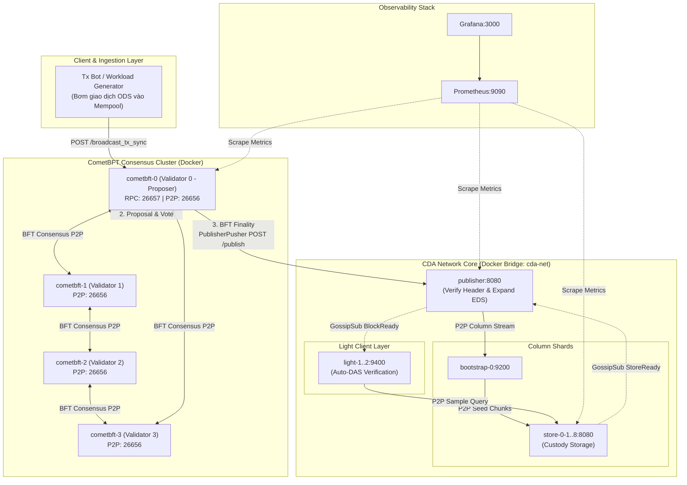

# Kế Hoạch Triển Khai Cụm Docker CometBFT Hoàn Thiện Pipeline CDA Network

Tài liệu này trình bày kiến trúc và kế hoạch triển khai chi tiết nhằm đóng gói cụm **CometBFT Consensus** vào container Docker, kết nối trực tiếp với **CDA Network (Publisher -> Bootstrap -> Store -> Light)** để hoàn thiện pipeline sản xuất khối, đồng thuận BFT, lưu trữ DA và kiểm chứng DAS khép kín.

---

## 1. Hiện Trạng & Bài Toán Cần Giải Quyết

### 1.1. Hiện trạng kiểm thử
- **Tầng DA (Data Availability)**: Đã hoàn chỉnh từ Publisher, Bootstrap, Store (Custody $3,840$ mảnh) đến Light Node (Auto-DAS).
- **Tầng Đồng Thuận (Consensus)**: 
  - Code CometBFT trong thư mục [`cometbft/`](../../../cometbft) đã được tùy biến nhúng các trường cam kết CDA Header (`CommitsRoot`, `ColumnComm`, `Coeffs`) và cơ chế [`PublisherPusher`](../../../cometbft/state/publisher_pusher.go).
  - Tuy nhiên, việc chạy CometBFT trước đây chỉ dừng lại ở các bài test Go cục bộ (`go test ./cometbft/state`) hoặc script phát sinh khối giả lập (`test_pipeline_block_timing.py`) đẩy trực tiếp vào REST API của Publisher.
  - **Chưa có cụm Validator CometBFT chạy container độc lập** cùng mạng Docker với cụm CDA Network.

### 1.2. Mục tiêu đạt được
1. **Container hóa CometBFT**: Đóng gói binary CometBFT kèm ứng dụng ABCI vào Docker image tối ưu.
2. **Cụm Đa Validator (Multi-Validator Cluster)**: Dựng cụm $V$ node validator (mặc định $V=4$ để đảm bảo tính chịu lỗi BFT $3f+1$, hỗ trợ mở rộng $V=1..N$).
3. **Pipeline Khép Kín Tự Động**:
   $$\text{Client Tx} \xrightarrow{\text{RPC}} \text{CometBFT Cluster} \xrightarrow{\text{BFT Finality}} \text{Publisher} \xrightarrow{\text{P2P}} \text{Bootstrap/Store} \xrightarrow{\text{DAS}} \text{Light Nodes}$$
4. **Tích hợp vào Bộ Sinh Cấu Hình**: Cập nhật [`scripts/generate_compose.py`](../../../scripts/generate_compose.py) để tự động sinh cả cụm CometBFT lẫn cụm CDA Network trong cùng một file `docker-compose.yml`.

---

## 2. Kiến Trúc Hệ Thống (End-to-End Pipeline)



---

## 3. Các Thành Phần Kỹ Thuật Cần Triển Khai

### 3.1. Dockerfile Cho CometBFT (`Dockerfile.cometbft`)
Sử dụng mô hình **Multi-Stage Build** để tối ưu hóa kích thước image:
- **Build Stage**: Go 1.23+ biên dịch binary `cometbft` từ module `cometbft/cmd/cometbft`.
- **Runtime Stage**: `alpine:3.19` bổ sung các công cụ cần thiết (`curl`, `jq`, `ca-certificates`).
- **Entrypoint**: Script khởi động hỗ trợ tự động nhận diện ID node, khởi tạo cấu hình nếu chưa có và chạy với cờ `--proxy_app=kvstore`.

```dockerfile
# Dockerfile.cometbft
FROM golang:1.23-alpine AS builder
RUN apk add --no-cache git make gcc musl-dev linux-headers
WORKDIR /src/cometbft
COPY cometbft/go.mod cometbft/go.sum ./
RUN go mod download
COPY cometbft/ ./
COPY rlnc-rsmt2d/ /src/rlnc-rsmt2d/
RUN CGO_ENABLED=0 GOOS=linux go build -o /bin/cometbft ./cmd/cometbft

FROM alpine:3.19
RUN apk add --no-cache curl jq bash ca-certificates
WORKDIR /cometbft
COPY --from=builder /bin/cometbft /usr/local/bin/cometbft
COPY scripts/cometbft_entrypoint.sh /usr/local/bin/entrypoint.sh
RUN chmod +x /usr/local/bin/entrypoint.sh

EXPOSE 26656 26657 26660
ENTRYPOINT ["/usr/local/bin/entrypoint.sh"]
CMD ["node", "--proxy_app", "kvstore"]
```

---

### 3.2. Script Khởi Tạo Cụm & Cấu Hình (`scripts/init_cometbft_cluster.sh`)
CometBFT đòi hỏi các validator phải có chung `genesis.json` và biết `persistent_peers` của nhau trước khi khởi động.
Quy trình tự động sinh cấu hình:
1. Dùng lệnh `cometbft testnet --v 4 --output-dir ./data/cometbft --node-dir-prefix node --populate-persistent-peers`.
2. Tùy biến `config.toml` cho từng node:
   - `timeout_commit = "1s"` hoặc `"500ms"` (đẩy nhanh tốc độ sinh block).
   - `cors_allowed_origins = ["*"]`.
   - `laddr = "tcp://0.0.0.0:26657"` (cho phép RPC từ bên ngoài container).
   - Thiết lập biến môi trường `PUBLISHER_URL=http://publisher:8080/publish`.
   - Thiết lập `CDA_K=64` (để `BuildODSFromTxs` khớp kích thước ma trận với CDA Network).

---

### 3.3. Tích Hợp Vào [`scripts/generate_compose.py`](../../../scripts/generate_compose.py)
Bổ sung các tham số dòng lệnh mới:
- `--cometbft-validators <V>`: Số lượng validator trong cụm (mặc định: `4`, hoặc `0` nếu không muốn bật CometBFT).
- Tự động sinh các service trong `docker-compose.yml`:
  ```yaml
  services:
    cometbft-0:
      build:
        context: .
        dockerfile: Dockerfile.cometbft
      container_name: cometbft-0
      environment:
        - NODE_ID=0
        - PUBLISHER_URL=http://publisher:8080/publish
        - CDA_K=64
      volumes:
        - ./data/cometbft/node0:/cometbft
      ports:
        - "26657:26657"   # RPC API
        - "26656:26656"   # P2P
      networks:
        - cda-net
      depends_on:
        - publisher

    cometbft-1:
      # Validator 1...
  ```

---

### 3.4. Transaction Generator Service (`tx_generator.py`)
Một tiến trình bơm giao dịch tự động vào CometBFT:
- Kết nối tới `http://localhost:26657/broadcast_tx_sync`.
- Bơm các giao dịch mang định dạng cell dữ liệu CDA ($K \times K$ cells).
- Theo dõi tiến trình:
  - Khi block được chốt (height tăng), hiển thị log `Block #H committed by CometBFT`.
  - Giám sát endpoint Publisher `http://localhost:8080/block-ready/latest` để đo đạc thời gian từ lúc nộp Tx đến khi Auto-DAS hoàn tất.

---

## 4. Lộ Trình Triển Khai Từng Bước (Implementation Phases)

| Giai đoạn | Nhiệm vụ chính | Deliverables / Files | Tiêu chí nghiệm thu |
| :--- | :--- | :--- | :--- |
| **Phase 1: Build & Packaging** | Viết `Dockerfile.cometbft` và script entrypoint. Kiểm tra build image trên máy local. | • `Dockerfile.cometbft`<br>• `scripts/cometbft_entrypoint.sh` | Build image thành công, binary chạy được `cometbft version`. |
| **Phase 2: Cluster Setup** | Viết script sinh cấu hình testnet cho $V$ validator nodes và tích hợp biến môi trường `PUBLISHER_URL`. | • `scripts/init_cometbft_cluster.py` | Sinh đủ keypair, genesis chung, peer ID khớp nhau. |
| **Phase 3: Compose Integration** | Cập nhật `generate_compose.py` để sinh cấu hình hợp nhất cho toàn bộ hệ thống. | • `scripts/generate_compose.py`<br>• `docker-compose-e2e.yml` | `docker compose config` hợp lệ, các node cùng mạng `cda-net`. |
| **Phase 4: Bridge Verification** | Khởi động cụm, kiểm tra CometBFT đẩy khối sang Publisher và Publisher Verify Header thành công. | • Log Publisher & CometBFT | Publisher in log `Header verification passed for Block BFT-H`. |
| **Phase 5: E2E Pipeline Benchmark** | Xây dựng script kiểm thử tự động toàn diện: Tx -> CometBFT -> Publisher -> Store -> Light Auto-DAS. | • `scripts/tests/benchmark/test_cometbft_e2e_pipeline.py` | 100% blocks hoàn thành Auto-DAS, Store Node đạt đúng 3,840 mảnh. |

---

## 5. Kế Hoạch Kiểm Thử & Tiêu Chí Nghiệm Thu

1. **Đồng thuận BFT hoàn thành**: Cụm 4 validator commit đều đặn các block mới ($H=1, 2, ...$).
2. **Xác thực BFT Header Zero-Trust**:
   - Khi Proposer đề xuất block với CDA Header hợp lệ $\to$ Validator vote chấp thuận $\to$ Commit $\to$ Publisher `VerifyHeader` trả về `200 OK`.
   - Nếu cố tình làm sai lệch một cell dữ liệu $\to$ Publisher từ chối phát tán với mã lỗi `422 Unprocessable Entity`.
3. **Tính nhất quán mảnh DA**:
   - Store Nodes vẫn giữ vững trạng thái **2,048 mảnh Primary**, **256 mảnh Backup**, **1,536 mảnh Non-custody** $\to$ Tổng **3,840 mảnh**.
4. **Light Node Auto-DAS**: Các Light Node lấy mẫu ngẫu nhiên $16$ cells và xác thực KZG Kate thành công $100\%$.
