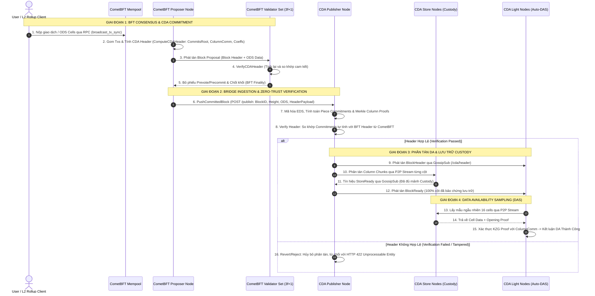

# Kiến Trúc Tích Hợp Đồng Thuận CometBFT & CDA Network Data Availability

Tài liệu này đặc tả toàn diện kiến trúc kỹ thuật của hệ thống **CDA Network (Data Availability Layer)** khi tích hợp với lớp đồng thuận **CometBFT Consensus Engine**, bao gồm mô hình phân tầng, cấu trúc dữ liệu mật mã, giao thức tương tác giữa các thành phần và cơ chế xác thực đa tầng (Multi-tier Verification).

---

## 1. Tổng Quan Kiến Trúc (Architecture Overview)

### 1.1. Bối cảnh & Vai trò của CometBFT trong Hệ Sinh Thái CDA
Trong mô hình Modular Blockchain, **CDA Network** chịu trách nhiệm cung cấp tính sẵn sàng dữ liệu (Data Availability - DA) với thông lượng cao và độ trễ thấp thông qua mã hóa xóa 2D (RSMT-2D), cam kết KZG Kate và mã hóa mạng ngẫu nhiên (RLNC).

Để chuyển đổi từ hệ thống độc lập dựa trên việc tạo khối giả lập sang mạng lưới sản xuất khối phi tập trung thực tế, **CometBFT** được tích hợp làm lớp đồng thuận chính:
- **CometBFT (Tầng Đồng Thuận - Consensus Layer)**: Tập hợp các Validator Node chạy thuật toán đồng thuận Byzantine Fault Tolerant (BFT Tendermint/CometBFT). Chịu trách nhiệm tiếp nhận giao dịch từ Client/Rollup, sắp xếp thứ tự khối, đóng gói ma trận dữ liệu gốc $K \times K$ (ODS), tính toán và xác thực các cam kết mật mã CDA (`CommitsRoot`, `ColumnComm`, `Coeffs`) trực tiếp trong chu trình đồng thuận trước khi chốt khối (BFT Finality).
- **Publisher Node (Tầng Phân Tán & Cầu Nối - DA Ingestion & Dissemination Layer)**: Đóng vai trò là cầu nối Zero-Trust tiếp nhận khối đã chốt từ CometBFT, đối soát xác thực lại toàn bộ BFT Header với cam kết độc lập, sau đó phân tách dữ liệu thành các cột và phát tán ra mạng P2P libp2p.
- **Bootstrap & Store Nodes (Tầng Lưu Trữ Bảo Chứng - Custody Storage Layer)**: Lưu trữ các mảnh mã hóa theo cơ chế Custody đa nhóm cột, đảm bảo trạng thái steady-state (ví dụ $3,840$ mảnh với $K=64$).
- **Light Nodes (Tầng Kiểm Chứng Khách Nhẹ - DAS Sampling Layer)**: Tiến hành lấy mẫu ngẫu nhiên (Data Availability Sampling - DAS) để xác thực tính sẵn sàng dữ liệu mà không cần tải toàn bộ block.

```
┌────────────────────────────────────────────────────────────────────────┐
│                        CLIENT / ROLLUP LAYER                           │
│              (Giao dịch L2 / Dữ liệu ODS Cells nộp qua RPC)             │
└───────────────────────────────────┬────────────────────────────────────┘
                                    │ CometBFT RPC: 26657
                                    ▼
┌────────────────────────────────────────────────────────────────────────┐
│                  COMETBFT BFT CONSENSUS LAYER                          │
│  ┌──────────────┐   ┌──────────────┐   ┌──────────────┐   ┌──────────┐ │
│  │ Validator 0  │───│ Validator 1  │───│ Validator 2  │───│ ... (V)  │ │
│  └──────┬───────┘   └──────────────┘   └──────────────┘   └──────────┘ │
│         │ (Mempool -> Propose -> BFT Consensus 3f+1 -> Commit)         │
│         │ Tính toán & Bỏ phiếu cam kết CDA Header                      │
└─────────┼──────────────────────────────────────────────────────────────┘
          │ PublisherPusher (HTTP POST /publish + BFT Header Payload)
          ▼
┌────────────────────────────────────────────────────────────────────────┐
│                   CDA PUBLISHER NODE (ZERO-TRUST)                      │
│   (Xác thực BFT Header -> Mở rộng EDS 2Kx2K -> Phân tán P2P)          │
└─────────┬──────────────────────────────────────────────────────────────┘
          │
    ┌─────┴──────────────────────────────────────────┐
    │ P2P Column Chunks Stream                       │ GossipSub BlockReady (/cda/block-ready)
    ▼                                                ▼
┌─────────────────────────────────────┐   ┌──────────────────────────────┐
│  BOOTSTRAP & STORE NODES (CUSTODY)  │   │   LIGHT NODES (AUTO-DAS)     │
│  - Bootstrap Node: KZG & RLNC Seed  │   │   - Lấy mẫu ngẫu nhiên DAS   │
│  - Store Nodes: Lưu trữ Custody     │   │   - Xác thực Kate Commitment │
└─────────────────────────────────────┘   └──────────────────────────────┘
```

---

## 2. Đặc Tả Cấu Trúc Dữ Liệu & Cryptographic Primitives

### 2.1. Mở Rộng Block Header (`cometbft/types/block.go`, `cometbft/proto/tendermint/types/types.proto`)
Để gắn kết tính toàn vẹn của dữ liệu DA vào tính hữu hiệu của khối BFT, cấu trúc `Header` của CometBFT được mở rộng 3 trường cam kết mật mã gốc (Root of Trust):

```go
type Header struct {
    // ... Các trường tiêu chuẩn của CometBFT (Version, ChainID, Height, Time, LastBlockID, DataHash, ...)
    
    // CDA Root of Trust fields
    CommitsRoot cmtbytes.HexBytes `json:"commits_root"` // Merkle Root của tất cả piece commitments
    ColumnComm  [][]byte          `json:"column_comm"`  // Cam kết KZG Kate của 2K cột trong EDS
    Coeffs      []byte            `json:"coeffs"`       // Hệ số mã hóa RLNC tạo ra bởi Fiat-Shamir
}
```

- **`CommitsRoot`**: Giá trị băm 32 bytes của gốc cây Merkle xây dựng trên mảng các cam kết KZG piece commitments của ma trận EDS.
- **`ColumnComm`**: Mảng $2K$ cam kết điểm trên đường cong elliptic BLS12-381 (G1 point, 48 bytes nén), đại diện cho từng cột của ma trận mở rộng EDS.
- **`Coeffs`**: Chuỗi bytes chứa vector hệ số ngẫu nhiên phục vụ mã hóa mạng tuyến tính RLNC.

### 2.2. Mở Rộng Block Data (`cometbft/types/block.go`)
Dữ liệu khối của CometBFT hỗ trợ ma trận dữ liệu gốc ODS (Original Data Square):

```go
type ODSData struct {
    K     int      `json:"k"`     // Kích thước ma trận gốc (K x K)
    Cells [][]byte `json:"cells"` // Mảng K*K ô dữ liệu (mỗi ô kích thước chuẩn, ví dụ 512 bytes)
}

type Data struct {
    Txs  Txs      `json:"txs"`
    ODS  ODSData  `json:"ods"`   // Lưu trữ trực tiếp ODS cells
}
```

Khi đóng khối, nếu block có giao dịch `Txs`, hàm `BuildODSFromTxs` sẽ tự động gom các giao dịch thành ma trận ODS $K \times K$.

### 2.3. Đối Chiếu Các Hàm Thư Viện Lõi `rlnc-rsmt2d`

Bảng đối chiếu việc sử dụng thư viện mật mã lõi [`rlnc-rsmt2d`](file:///home/ubuntu/cda-network/rlnc-rsmt2d) xuyên suốt hệ thống:

| Gói Core `rlnc-rsmt2d` | Hàm / Cấu trúc | Vị trí gọi trong hệ thống CDA | Vai trò kiến trúc |
| :--- | :--- | :--- | :--- |
| **`cda`** | `cda.ComputeExtendedDataSquareWithLeopard(odsData)` | • `cda-publisher-node/internal/engine/pipeline.go`<br>• `cometbft/state/cda_engine.go` | Mở rộng ma trận ODS $K \times K$ thành ma trận 2D EDS ($2K \times 2K$) bằng thuật toán Leopard Reed-Solomon. |
| **`cda`** | `cda.ComputeAndSetKateCommitments(codec, &eds, kzg, seed)` | • `cda-publisher-node/internal/engine/pipeline.go`<br>• `cometbft/state/cda_engine.go` | Tính mảng cam kết cột `ColumnComm` và piece commitments thông qua biến đổi Fiat-Shamir. |
| **`cda`** | `cda.BuildMerkleTree(pieceCommitsBytes)` | • `cda-publisher-node/internal/engine/pipeline.go`<br>• `cometbft/state/cda_engine.go` | Xây dựng Merkle Tree từ piece commitments, tạo ra `CommitsRoot` và các bằng chứng Merkle cột. |
| **`cda`** | `cda.NewGnarkKZG(srs)` | • `cda-publisher-node/internal/engine/pipeline.go`<br>• `cometbft/state/cda_engine.go`<br>• `cda-light-node/cmd/light/main.go` | Khởi tạo engine KZG Commitment trên đường cong BLS12-381 với Structured Reference String (SRS). |
| **`cda`** | `cda.VerifyMerkleProof(root, leaf, proof)` | • `cda-store-node/internal/verifier/piece_verify.go` | Store Node xác thực Layer 1 (Merkle Root) cho các piece commitments của cột custody. |
| **`cda`** | `kzg.Combine` & `kzg.Verify` | • `cda-store-node/internal/verifier/piece_verify.go`<br>• `cda-light-node/internal/verifier/das_verifier.go` | Xác thực tính hợp lệ của mảnh dữ liệu so với `ColumnComm` (Layer 2 KZG Evaluation Proof). |
| **`rlnc`** | `rlnc.NewRLNCCodec(k)` & `rlnc.SolveGaussian(A, B)` | • `cda-publisher-node/internal/engine/pipeline.go`<br>• `cometbft/state/cda_engine.go`<br>• `cda-light-node/internal/verifier/das_verifier.go` | Khởi tạo codec RLNC và giải hệ phương trình tuyến tính khử Gauss trên trường hữu hạn $F_r$. |
| **`rsmt2d`** | `rsmt2d.ExtendedDataSquare` | • `cda-publisher-node/internal/engine/pipeline.go`<br>• `cometbft/state/cda_engine.go` | Cấu trúc dữ liệu biểu diễn ma trận 2D đã mã hóa xóa. |

### 2.4. Giao Thức Chuyển Giao BFT Bridge (`PublisherPusher`)
Khi một khối đạt đồng thuận BFT và commit vào StateDB của CometBFT, thành phần [`PublisherPusher`](file:///home/ubuntu/cda-network/cometbft/state/publisher_pusher.go) tự động đóng gói payload và gửi sang Publisher Node qua HTTP REST API:

```go
type HeaderPayload struct {
    CommitsRoot string   `json:"commits_root,omitempty"`
    ColumnComm  []string `json:"column_comm,omitempty"`
    Coeffs      string   `json:"coeffs,omitempty"`
}

type PublishRequest struct {
    BlockID   string         `json:"block_id"`
    Height    int64          `json:"height,omitempty"`
    Data      []string       `json:"data"`   // Mảng hex của K*K ODS cells
    Header    *HeaderPayload `json:"header,omitempty"`
    Signature string         `json:"signature,omitempty"`
}
```

---

## 3. Luồng Vòng Đời Dữ Liệu Toàn Trình (End-to-End Data Lifecycle)



---

## 4. Mô Hình Xác Thực Mật Mã Đa Tầng (Multi-Tier Verification Model)

Hệ thống thiết lập nguyên lý **Zero-Trust** xuyên suốt từ khâu đồng thuận đến khâu người dùng cuối:

```
┌────────────────────────────────────────────────────────────────────────┐
│ Layer 0: BFT Consensus Finality                                       │
│ Thuật toán BFT CometBFT: Chống lỗi Byzantine lên tới f < N/3           │
└───────────────────────────────────┬────────────────────────────────────┘
                                    │
┌───────────────────────────────────▼────────────────────────────────────┐
│ Layer 1: Consensus CDA Verification (CometBFT Validators)             │
│ Hàm: VerifyCDAHeader(block) trong pha ProcessProposal                   │
│ Đảm bảo Proposer không đề xuất khối chứa cam kết Header sai lệch      │
└───────────────────────────────────┬────────────────────────────────────┘
                                    │
┌───────────────────────────────────▼────────────────────────────────────┐
│ Layer 2: Ingestion Active Verification (CDA Publisher Node)           │
│ Hàm: VerifyCDAHeader(computedHeader, bftHeader) trong handlePublish    │
│ Chống giả mạo đường truyền/tấn công MITM giữa CometBFT và Publisher    │
└───────────────────────────────────┬────────────────────────────────────┘
                                    │
┌───────────────────────────────────▼────────────────────────────────────┐
│ Layer 3: Custody Storage Verification (CDA Store Nodes)               │
│ - Sub-tier 3.1: Layer 1 Merkle Root Check (cda.VerifyMerkleProof)     │
│ - Sub-tier 3.2: Layer 2 KZG Kate Commitment Check (kzg.Verify)        │
│ Đảm bảo Store Node chỉ nhận và lưu các mảnh hợp lệ từ Bootstrap        │
└───────────────────────────────────┬────────────────────────────────────┘
                                    │
┌───────────────────────────────────▼────────────────────────────────────┐
│ Layer 4: Client Sampling Verification (CDA Light Nodes Auto-DAS)      │
│ Khách nhẹ lấy mẫu 16 ô ngẫu nhiên và đối chiếu với BlockHeader công khai│
│ Đảm bảo xác suất phát hiện khối bị giấu dữ liệu đạt > 99.99%           │
└────────────────────────────────────────────────────────────────────────┘
```

### Bảng So Sánh Cơ Chế Xác Thực Giữa Validator Node và Publisher Node

| Đặc Tính Xác Thực | Validator Node (`VerifyCDAHeader`) | Publisher Node (`Verify Header`) |
| :--- | :--- | :--- |
| **Thời điểm thực thi** | Trong vòng đồng thuận BFT (`ProcessProposal`) | Ngay khi nhận khối committed từ CometBFT (`handlePublish`) |
| **Dữ liệu đầu vào** | `types.Block` (ODS Data + Proposed Header) | `PublishRequest` (ODS Data + Finalized BFT Header Commitments) |
| **Mục đích** | Quyết định bỏ phiếu Prevote/Precommit chấp thuận khối | Quyết định chấp thuận phát tán DA tới Store Nodes và Light Nodes |
| **Thuật toán đối soát** | Tính EDS, Kate commitments, Merkle Root và so khớp với Header | Tính EDS, Kate commitments, Merkle Root và so khớp với BFT Header |
| **Hành vi khi vi phạm** | Bác bỏ proposal, vote `nil` / Reject proposal | Từ chối HTTP request (422), hủy phân tán, bảo vệ Store & Light Nodes |

---

## 5. Đặc Tả Giao Diện & Kênh Truyền Thông (Interface Specifications)

| Kênh Giao Tiếp | Giao Thức | Endpoint / Topic | Chi Tiết Dữ Liệu |
| :--- | :--- | :--- | :--- |
| **Client $\to$ CometBFT** | HTTP / JSON-RPC | `POST /broadcast_tx_sync`<br>`POST /broadcast_tx_commit` | Payload giao dịch ODS cells |
| **CometBFT $\leftrightarrow$ CometBFT** | P2P TCP (MConn) | Port `26656` | Thông điệp đồng thuận Tendermint (Propose, Prevote, Precommit) |
| **CometBFT $\to$ Publisher** | HTTP REST | `POST /publish` | `PublishRequest` (ODS cells + `HeaderPayload`) |
| **Publisher $\leftrightarrow$ Bootstrap** | Libp2p Stream | Protocol `/cda/chunk/1.0.0` | Column Chunks + Piece Commitments + Merkle Proofs |
| **Bootstrap $\to$ Store** | Libp2p Stream | Protocol `/cda/seed/1.0.0`<br>`/cda/binary-batch/1.0.0` | RLNC Seed Pieces và KZG opening proofs theo từng hàng |
| **Store $\to$ Publisher** | Libp2p GossipSub | Topic `/cda/store-ready` | Tín hiệu hoàn thành lưu trữ Custody theo cột |
| **Publisher $\to$ Light** | Libp2p GossipSub | Topic `/cda/header`<br>`Topic /cda/block-ready` | Block Header công khai và tín hiệu khối sẵn sàng DAS |
| **Light $\to$ Store** | Libp2p Stream | Protocol `/cda/sample/1.0.0` | Truy vấn lấy mẫu DAS và phản hồi kèm bằng chứng KZG |

---

## 6. Cơ Chế Kháng Lỗi, Liveness & An Toàn Mạng Lưới

### 6.1. Phòng Thủ Chống Gian Lận (Byzantine Fault Defense)
- **Nếu Proposer gửi sai ODS hoặc sai Header**: Các Validator khác trong cụm CometBFT sẽ phát hiện sai lệch khi gọi `VerifyCDAHeader(block)` $\to$ Block proposal bị từ chối $\to$ Proposer khác được chọn trong round tiếp theo.
- **Nếu Bridge hoặc dữ liệu nộp sang Publisher bị lỗi**: Publisher chạy hàm `VerifyCDAHeader` đối chiếu độc lập. Nếu không khớp `CommitsRoot`, `ColumnComm` hoặc `Coeffs`, Publisher lập tức phản hồi `HTTP 422 Unprocessable Entity` và từ chối phát tán, ngăn chặn ô nhiễm dữ liệu trên toàn mạng DA.

### 6.2. Pipeline Queue & Độc Lập Luồng Đồng Thuận
- Để đảm bảo CometBFT không bị nghẽn (block) nếu tầng DA phân tán chậm, goroutine trong `execution.go` đẩy khối sang Publisher chạy **bất đồng bộ** (`go pusher.PushCommittedBlock(b)`).
- Phía Publisher áp dụng cơ chế **Pipeline Sequential Gate** (`PUBLISHER_MAX_IN_FLIGHT=2`, `PUBLISHER_QUEUE_TIMEOUT=300s`) cho phép nạp trước khối tiếp theo để tính toán trước (pre-computation) trong khi khối trước đó đang đợi StoreReady.

---

## 7. Ánh Xạ Thành Phần Mã Nguồn (Architecture Component Mapping)

| Thành Phần Kiến Trúc | Đường Dẫn Mã Nguồn | Trách Nhiệm Chính |
| :--- | :--- | :--- |
| **Block Header & Data** | [`cometbft/types/block.go`](file:///home/ubuntu/cda-network/cometbft/types/block.go) | Định nghĩa cấu trúc `Header` (CommitsRoot, ColumnComm, Coeffs) và `ODSData`. |
| **CDA Engine** | [`cometbft/state/cda_engine.go`](file:///home/ubuntu/cda-network/cometbft/state/cda_engine.go) | Thư viện tính toán EDS, KZG commitments và Merkle root cho ODS. |
| **Consensus Validation** | [`cometbft/state/validation.go`](file:///home/ubuntu/cda-network/cometbft/state/validation.go) | Hàm `VerifyCDAHeader` xác thực khối trong pha `ProcessProposal` của Validator. |
| **Block Executor** | [`cometbft/state/execution.go`](file:///home/ubuntu/cda-network/cometbft/state/execution.go) | Tạo khối đề xuất `MakeBlock` và tự động kích hoạt `PublisherPusher` khi commit. |
| **Publisher Bridge** | [`cometbft/state/publisher_pusher.go`](file:///home/ubuntu/cda-network/cometbft/state/publisher_pusher.go) | Đóng gói và chuyển giao dữ liệu block + BFT Header commitments tới HTTP REST API Publisher. |
| **Publisher API & Verifier** | [`cda-publisher-node/internal/service/api.go`](file:///home/ubuntu/cda-network/cda-publisher-node/internal/service/api.go) | REST API `/publish` tiếp nhận block, **xác thực BFT Header**, mã hóa EDS và phân tán custody. |
| **Custody Storage** | [`cda-store-node/internal/storage/custody.go`](file:///home/ubuntu/cda-network/cda-store-node/internal/storage/custody.go) | Lưu trữ $3,840$ mảnh bảo chứng, quản lý cache bộ nhớ và cơ chế pruning raw pieces. |
| **Light Client DAS** | [`cda-light-node/internal/verifier/das_verifier.go`](file:///home/ubuntu/cda-network/cda-light-node/internal/verifier/das_verifier.go) | Thực hiện lấy mẫu ngẫu nhiên DAS và xác thực bằng chứng Kate. |

---

## 8. Tài Liệu Tham Chiếu & Triển Khai
Kế hoạch chi tiết về việc container hóa và triển khai cụm CometBFT trong Docker Compose được đặc tả tại:
👉 [`docs/system/deploy/cometbft_docker_cluster_plan.md`](file:///home/ubuntu/cda-network/docs/system/deploy/cometbft_docker_cluster_plan.md)
