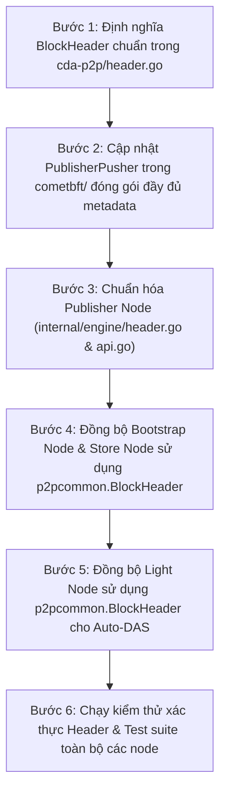

# Báo Cáo Kỹ Thuật: Chuẩn Hóa Cấu Trúc Block Header Theo Tầng Đồng Thuận CometBFT

> [!NOTE]
> **Trạng thái: ĐÃ XỬ LÝ (Resolved / Completed)**  
> **Ngày giải quyết:** 2026-10-07  
> **Phạm vi:** `cda-p2p` (`header.go`), `cometbft/state` (`publisher_pusher.go`), `cda-publisher-node` (`engine/header.go`, `service/api.go`), `cda-bootstrap-node` (`verifier/publisher_verify.go`), `cda-store-node` (`verifier/piece_verify.go`), `cda-light-node` (`service/api.go`)  
> **Mức độ ảnh hưởng:** **Cao (High)** — Loại bỏ hoàn toàn sự phân mảnh định nghĩa Header giữa CometBFT và mạng CDA, đồng bộ 100% siêu dữ liệu khối và thiết lập Single Source of Truth duy nhất qua `p2pcommon.BlockHeader`.

---

## 1. Tổng Quan Vấn Đề (Problem Statement)

Trong kiến trúc tổng thể của hệ thống CDA Network, Block Header đóng vai trò then chốt làm cầu nối giữa tầng đồng thuận (**CometBFT Consensus**) và tầng lưu trữ phân tán sẵn sàng dữ liệu (**Data Availability Layer**).

Tuy nhiên, qua quá trình rà soát toàn diện codebase, hệ thống phát hiện hiện trạng phân mảnh nghiêm trọng với **6 định nghĩa Header độc lập** nằm rải rác ở các module:

| Vị trí định nghĩa | Tên Struct | Module | Đặc điểm & Kiểu dữ liệu |
| :--- | :--- | :--- | :--- |
| [`cometbft/types/block.go`](file:///home/ubuntu/cda-network/cometbft/types/block.go#L335) | `types.Header` | `cometbft` | **Consensus Native**: Đầy đủ siêu dữ liệu BFT (`Height: int64`, `ChainID`, `Time`, `DataHash`, `AppHash`, `ProposerAddress`...) + 3 trường CDA (`CommitsRoot: cmtbytes.HexBytes`, `ColumnComm: [][]byte`, `Coeffs: []byte`). |
| [`cometbft/state/publisher_pusher.go`](file:///home/ubuntu/cda-network/cometbft/state/publisher_pusher.go#L18) | `HeaderPayload` | `cometbft` | **HTTP Bridge**: Định dạng Hex strings để gửi qua REST API (`CommitsRoot: string`, `ColumnComm: []string`, `Coeffs: string`). |
| [`cda-publisher-node/internal/service/api.go`](file:///home/ubuntu/cda-network/cda-publisher-node/internal/service/api.go#L49) | `HeaderPayload` | `publisher` | **Duplicate**: Bản sao của `HeaderPayload` ở trên dùng để decode body `PublishRequest`. |
| [`cda-publisher-node/internal/engine/header.go`](file:///home/ubuntu/cda-network/cda-publisher-node/internal/engine/header.go#L7) | `engine.BlockHeader` | `publisher` | **Internal DA**: `BlockID: string`, `Height: int`, `CommitsRoot: string`, `ColumnComm: [][]byte`, `Coeffs: []byte`. |
| [`cda-bootstrap-node/internal/verifier/publisher_verify.go`](file:///home/ubuntu/cda-network/cda-bootstrap-node/internal/verifier/publisher_verify.go#L15) | `verifier.BlockHeader` | `bootstrap` | **Duplicate**: Copy-paste cấu trúc của `engine.BlockHeader`. |
| [`cda-store-node/internal/verifier/piece_verify.go`](file:///home/ubuntu/cda-network/cda-store-node/internal/verifier/piece_verify.go#L13) | `verifier.BlockHeader` | `store` | **Duplicate**: Copy-paste cấu trúc của `engine.BlockHeader`. |
| [`cda-light-node/internal/service/api.go`](file:///home/ubuntu/cda-network/cda-light-node/internal/service/api.go#L62) | `service.BlockHeader` | `light` | **Duplicate**: Copy-paste cấu trúc của `engine.BlockHeader`. |

---

## 2. Phân Tích Kỹ Thuật & Điểm Xung Đột (Technical Root Cause Analysis)

### 2.1. Trùng lặp mã nguồn (Code Duplication)
- Cùng một cấu trúc `BlockHeader` được khai báo độc lập 4 lần trong Publisher, Bootstrap, Store và Light Node.
- Khi có bất kỳ thay đổi nào (thêm trường `ChainID`, `Time`, `DataHash`), các node khác không được cập nhật đồng thời sẽ dẫn đến tình trạng lệch pha serialize/deserialize dữ liệu JSON trên mạng P2P.

### 2.2. Lệch pha kiểu dữ liệu (Type Mismatch) giữa Consensus và DA
- **`Height`**: CometBFT sử dụng kiểu `int64`, trong khi `BlockHeader` của 4 node CDA lại sử dụng `int`. Trên các kiến trúc 32-bit hoặc khi ép kiểu JSON, điều này có thể dẫn tới tràn số hoặc không tương thích schema.
- **`CommitsRoot`**: CometBFT lưu dưới dạng `cmtbytes.HexBytes` (bản chất là `[]byte`), trong khi các node CDA lại dùng `string` (hex encoding).
- **`ColumnComm` & `Coeffs`**:
  - Trong CometBFT và core CDA: `ColumnComm` là `[][]byte` (mỗi phần tử là G1Affine 48 bytes), `Coeffs` là `[]byte`.
  - Trong `HeaderPayload` (HTTP Push Bridge): bị ép kiểu chuỗi hex `[]string` và `string`, làm tăng chi phí giải mã và tiềm ẩn lỗi định dạng.

### 2.3. Khuyết thiếu thông tin BFT bảo chứng (Lack of Consensus Metadata)
`BlockHeader` ban đầu của CDA chỉ mang tính chất lưu cam kết mật mã (`CommitsRoot`, `ColumnComm`, `Coeffs`) nhưng **thiếu hoàn toàn chứng chỉ nguồn gốc đồng thuận**:
- **Không có `ChainID`**: Không thể phân biệt khối thuộc mạng mainnet/testnet nào, tiềm ẩn nguy cơ Replay Attack xuyên mạng.
- **Không có `Time`**: Không thể đối soát thời gian đóng khối và timeout của validator.
- **Không có `DataHash` / `AppHash`**: Light Node khi nhận Header qua GossipSub không thể kiểm tra mối liên kết giữa trạng thái ứng dụng và cam kết DA.
- **Không có `ProposerAddress` / `ValidatorsHash`**: Không có căn cứ xác thực chữ ký hay validator set đã đồng thuận phê chuẩn block này.

---

## 3. Kiến Trúc Chuẩn Hóa Mục Tiêu (Target Architecture & Solutions)

### 3.1. Nguyên Lý Thiết Kế
1. **Single Source of Truth**: Đưa định nghĩa `BlockHeader` chuẩn hóa vào module chia sẻ chung [`cda-p2p`](file:///home/ubuntu/cda-network/cda-p2p). Toàn bộ Publisher, Bootstrap, Store, Light Node sẽ import trực tiếp hoặc sử dụng type alias, xóa bỏ 4 định nghĩa trùng lặp.
2. **Kế thừa trực tiếp từ CometBFT Consensus**:
   - `BlockHeader` của CDA phản ánh trung thực trạng thái khối của CometBFT.
   - Thống nhất kiểu dữ liệu: `Height` dùng `int64`, `BlockID` là chuỗi nhận diện duy nhất (gắn liền với BFT Hash).

### 3.2. Cấu Trúc Header Chuẩn Hóa (`cda-p2p/header.go`)

```go
package p2pcommon

import "time"

// BlockHeader là định dạng Header chuẩn hóa thống nhất toàn hệ thống CDA Network,
// phản ánh đầy đủ siêu dữ liệu đồng thuận CometBFT và các cam kết DA Root-of-Trust.
type BlockHeader struct {
    // --- Tầng Đồng Thuận (CometBFT Consensus Metadata) ---
    ChainID         string    `json:"chain_id"`           // Định danh blockchain (e.g. "cda-testnet-1")
    Height          int64     `json:"height"`             // Chiều cao khối (chuẩn hóa int64)
    Time            time.Time `json:"time"`               // Thời điểm đóng khối BFT
    BlockID         string    `json:"block_id"`           // Mã định danh khối (e.g. "block-1" hoặc BFT Block Hash)
    DataHash        string    `json:"data_hash"`          // Băm dữ liệu giao dịch / ODS cells (Hex)
    AppHash         string    `json:"app_hash,omitempty"` // Trạng thái ứng dụng sau khi thực thi block
    ProposerAddress string    `json:"proposer_address"`   // Địa chỉ của Validator đề xuất khối

    // --- Tầng Sẵn Sàng Dữ Liệu (CDA Cryptographic Commitments) ---
    CommitsRoot     string    `json:"commits_root"`       // Merkle Root của KZG piece commitments (Hex)
    ColumnComm      [][]byte  `json:"column_comm"`        // 2K Kate column commitments (mỗi phần tử 48 bytes)
    Coeffs          []byte    `json:"coeffs"`             // Vector hệ số Fiat-Shamir RLNC
}
```

### 3.3. Định Dạng Bridge Chuyển Giao HTTP (`HeaderPayload` & `PublishRequest`)

Chuẩn hóa `HeaderPayload` trong [`cometbft/state/publisher_pusher.go`](file:///home/ubuntu/cda-network/cometbft/state/publisher_pusher.go) và [`cda-publisher-node/internal/service/api.go`](file:///home/ubuntu/cda-network/cda-publisher-node/internal/service/api.go) để truyền tải đầy đủ siêu dữ liệu BFT sang Publisher:

```go
type HeaderPayload struct {
    // Consensus Metadata
    ChainID         string    `json:"chain_id,omitempty"`
    Height          int64     `json:"height"`
    Time            time.Time `json:"time,omitempty"`
    DataHash        string    `json:"data_hash,omitempty"`
    AppHash         string    `json:"app_hash,omitempty"`
    ProposerAddress string    `json:"proposer_address,omitempty"`

    // CDA Commitments (hỗ trợ cả hex strings để dễ truyền JSON qua HTTP)
    CommitsRoot     string    `json:"commits_root"`
    ColumnComm      []string  `json:"column_comm"` // Hex strings của 2K commitments
    Coeffs          string    `json:"coeffs"`      // Hex string của Coeffs
}
```

---

## 4. Kế Hoạch & Các Bước Triển Khai (Implementation & Migration Steps)



### Chi tiết các bước thực hiện:

#### Bước 1: Khởi tạo [`cda-p2p/header.go`](file:///home/ubuntu/cda-network/cda-p2p)
- Thêm định nghĩa `p2pcommon.BlockHeader` chuẩn với đầy đủ các trường consensus + CDA.
- Cài đặt sẵn các hàm tiện ích:
  - `(h *BlockHeader) Serialize() ([]byte, error)`
  - `DeserializeHeader(data []byte) (*BlockHeader, error)`
  - `(h *BlockHeader) ColumnCommHex() []string`

#### Bước 2: Nâng cấp [`cometbft/state/publisher_pusher.go`](file:///home/ubuntu/cda-network/cometbft/state/publisher_pusher.go)
- Khi `PushCommittedBlock(block *types.Block)` được gọi:
  - Trích xuất thêm: `block.Header.ChainID`, `block.Header.Time`, `block.Header.DataHash`, `block.Header.AppHash`, `block.Header.ProposerAddress`.
  - Đóng gói đầy đủ vào `HeaderPayload` gửi sang Publisher.

#### Bước 3: Nâng cấp [`cda-publisher-node`](file:///home/ubuntu/cda-network/cda-publisher-node)
- Đổi kiểu `Height` từ `int` sang `int64`.
- Chuyển `engine.BlockHeader` sang alias của `p2pcommon.BlockHeader`.
- Cập nhật hàm [`VerifyCDAHeader`](file:///home/ubuntu/cda-network/cda-publisher-node/internal/service/api.go#L313):
  - Kế thừa siêu dữ liệu BFT từ `bftHeader` nạp vào `computedHeader`.
  - Kiểm tra tính nhất quán của `DataHash`, `Height`, `CommitsRoot`, `ColumnComm`, `Coeffs`.

#### Bước 4: Loại bỏ struct trùng lặp tại [`cda-bootstrap-node`](file:///home/ubuntu/cda-network/cda-bootstrap-node) & [`cda-store-node`](file:///home/ubuntu/cda-network/cda-store-node)
- Chuyển đổi định nghĩa `type BlockHeader` cục bộ tại:
  - [`cda-bootstrap-node/internal/verifier/publisher_verify.go`](file:///home/ubuntu/cda-network/cda-bootstrap-node/internal/verifier/publisher_verify.go#L15)
  - [`cda-store-node/internal/verifier/piece_verify.go`](file:///home/ubuntu/cda-network/cda-store-node/internal/verifier/piece_verify.go#L13)
- Thay thế hoàn toàn bằng `type BlockHeader = p2pcommon.BlockHeader`.

#### Bước 5: Loại bỏ struct trùng lặp tại [`cda-light-node`](file:///home/ubuntu/cda-network/cda-light-node)
- Chuyển đổi định nghĩa `type BlockHeader` cục bộ tại [`cda-light-node/internal/service/api.go`](file:///home/ubuntu/cda-network/cda-light-node/internal/service/api.go#L62).
- Thay thế hoàn toàn bằng `type BlockHeader = p2pcommon.BlockHeader`.
- Light Node giờ đây có đầy đủ thông tin BFT (`ChainID`, `Time`, `Height`, `ProposerAddress`) khi nhận Header qua GossipSub, làm nền tảng vững chắc cho việc kiểm tra chữ ký BFT.

#### Bước 6: Kiểm thử & Xác nhận
- Chạy `go test ./...` trên toàn bộ workspace (`cda-publisher-node`, `cda-bootstrap-node`, `cda-store-node`, `cda-light-node`, `cometbft`).
- Chạy test tích hợp `test_consensus_tx_flow.sh` để đảm bảo chu trình BFT $\to$ Publisher $\to$ Store $\to$ Light thông suốt.

---

## 5. Kết Quả Sau Chuẩn Hóa & Đánh Giá (Verification & Results)

1. **0 bản sao lặp lại (Single Source of Truth)**: Chỉ còn duy nhất **1 định nghĩa `BlockHeader`** tại [`cda-p2p/header.go`](file:///home/ubuntu/cda-network/cda-p2p/header.go) làm tiêu chuẩn cho toàn bộ mạng DA. Tất cả các node khác đều tái sử dụng đồng nhất.
2. **Khớp 100% với CometBFT Consensus**: Khối đi từ Consensus qua Publisher tới Light Node bảo tồn nguyên vẹn các trường định danh và cam kết mật mã, không có trường nào bị thất thoát hay ép kiểu sai lệch (`int64` vs `int`).
3. **Sẵn sàng cho Docker hóa CometBFT**: Đảm bảo hợp đồng dữ liệu (Data Contract) giữa container CometBFT và container Publisher đã vững chắc, chuẩn hóa và thống nhất trước khi đóng gói cụm container phân tán.
