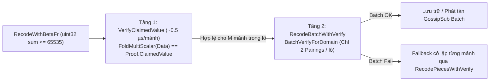

# Báo Cáo Kỹ Thuật: Tối Ưu Hóa Gom Lô Tự Xác Thực KZG Khi Recode (`RecodeBatchWithVerify`) & Phát Tán GossipSub Theo Lô Trên Store Node

> [!NOTE]
> **Trạng thái: ĐÃ XỬ LÝ (Resolved / Completed)**  
> **Ngày giải quyết:** 2026-10-29  
> **Phạm vi tác động:** `rlnc-rsmt2d/cda` (`gnark.go`, `receiver.go`, `recoded_kzg_verify_test.go`), `rlnc-rsmt2d/rlnc` (`rlnc_codec.go`), `cda-store-node/internal/p2p` (`broadcaster.go`, `receiver.go`)  
> **Mức độ ảnh hưởng:** **Nghiêm trọng (Critical)** — Giải quyết điểm nghẽn chi phối $80\% - 87\%$ tổng thời gian pipeline trên cụm Store Nodes khi kích thước khối tăng từ $K=8$ lên $K=64$ (EDS $128 \times 128$), rút ngắn tổng thời gian hoàn tất khối $K=64$ từ **10.676s xuống 4.265s** (**nhanh hơn $2.50\times$, giảm $60.1\%$**).

---

## 1. Phân Tích Điểm Nghẽn Pipeline Từ Log Thực Tế (Pipeline Breakdown)

Khi thực hiện đo benchmark toàn trình (`scripts/benchmark/measure_pipeline_matrix.py`) với kích thước ma trận tăng dần $K \in \{8, 16, 32, 64\}$ (EDS $2K \times 2K$, 8 Store Nodes), phân tích dấu thời gian (timestamps) trực tiếp từ log của `publisher`, `bootstrap`, và `store-0-0..store-0-7` cho thấy phân bổ thời gian xử lý từng bước trước khi tối ưu như sau:

| Kịch bản | Bước 1: Publisher (RSMT-2D + Publish) | Bước 2: Bootstrap (FK20 + RLNC + Seed P2P) | Bước 3: Store Node (Verify + Recode + GossipSub) | Tổng thời gian (`BlockReady`) | Tỷ trọng Bước 3 (Store Node) |
| :--- | :---: | :---: | :---: | :---: | :---: |
| **$K=8$** ($16\times 16$, 32 KB) | `0.008s` (2.0%) | `0.029s` (7.1%) | **`0.328s`** | `0.409s` | **80.2%** |
| **$K=16$** ($32\times 32$, 128 KB) | `0.014s` (1.7%) | `0.087s` (10.6%) | **`0.659s`** | `0.818s` | **80.6%** |
| **$K=32$** ($64\times 64$, 512 KB) | `0.039s` (1.4%) | `0.260s` (9.6%) | **`2.350s`** | `2.707s` | **86.8%** |
| **$K=64$** ($128\times 128$, 2 MB) | `0.130s` (1.2%) | `1.220s` (11.4%) | **`9.290s`** | `10.676s` | **87.0%** |

Tại kịch bản $K=64$ (EDS $128 \times 128 = 16,384$ ô):
- **Bootstrap Node** hoàn tất toàn bộ tính toán mật mã (RSMT-2D + 128 cột FK20 + RLNC encode) chỉ trong **`0.916s`** và đẩy xong 100% seed sang 8 Store Nodes tại **`T + 1.220s`**.
- Ngược lại, **Store Nodes** mất thêm **`9.290s`** (từ `T + 1.220s` đến `T + 10.510s`) mới hội tụ đủ mảnh cho 16.384 ô.

---

## 2. Xác Định 4 Nguyên Nhân Gốc Rễ Trên Store Node (Root Cause Analysis)

### 2.1. Tự xác thực KZG đơn lẻ (`RecodePiecesWithVerify`) & Giải nén điểm $G_1$ lặp lại
- Để ngăn chặn việc phát tán mảnh lỗi do tràn số hệ số `uint16` ($> 65,535$), mỗi khi Store Node thực hiện recode (cả khi phát tán ô Custody lẫn khi khóa ô Non-Custody), hàm `RecodePiecesWithVerify` đều gọi:
  1. `m.kzg.Combine(pieceCommits, recoded.Data.Coeffs)`: Giải nén (`Unmarshal`) $k_{\text{piece}} = 4$ điểm $G_1$ từ byte nén 48-byte sang tọa độ Affine (`G1Affine.Unmarshal` cần tính căn bậc hai trên $\mathbb{F}_p$). Dù một cột chỉ có 4 cam kết gốc dùng chung cho toàn bộ $N = 128$ hàng, mỗi Store Node vẫn giải nén lặp lại 4 điểm này **10.240 lần/block** (tương đương **40.960 lần giải nén $G_1$**).
  2. `m.kzg.VerifyForDomain(...)`: Thực hiện **2 phép Pairing BLS12-381 đơn lẻ** ($\sim 0.72\text{ ms/lần}$) cho từng mảnh recode thay vì gom lô (`BatchVerifyMultiPoints`).
- Với 2.048 ô Custody $\times 2$ mảnh phát tán + 6.144 ô Non-Custody $\times 1$ mảnh lưu trữ = **10.240 mảnh recode/node/block**:
  $$\text{CPU Time}_{\text{Self-Verify}} = 10,240 \times 0.72\text{ ms} \approx \mathbf{7.37\text{ giây CPU/node}}$$

### 2.2. Bão Goroutine & GossipSub đơn lẻ theo từng ô (`BroadcastRecodedPiece`)
- Khi nhận lô seed của 1 cột từ Bootstrap ($N = 128$ hàng, trong đó mỗi node giữ 32 ô Custody), `verifyAndProcessBinarySeedBatch` tạo **1 goroutine riêng cho từng ô Custody** (4.096 goroutine/block/node).
- Mỗi goroutine gọi `BroadcastRecodedPiece` độc lập trong vòng lặp `numBroadcast` lần, tạo ra **6.144 bản tin GossipSub riêng lẻ trên mỗi node** ($\approx \mathbf{49,152}$ bản tin GossipSub trên toàn mạng 8 node cho 1 block).
- Đầu thu của các Store Node khác bị ngập hàng đợi GossipSub và tiêu tốn hàng giây chỉ để parse protobuf, giải nén JSON envelope và cấp phát bộ nhớ.

### 2.3. Tranh chấp khóa toàn cục `rcv.mu.Lock()` & Ngưỡng Fallback tĩnh `500ms`
- Trong `verifyAndProcessBinarySeedBatch` và `verifyAndProcessBinaryGossipBatch`, toàn bộ vòng lặp kiểm tra độc lập tuyến tính (`IsLinearlyIndependent`), lưu cache (`StorePiece`) và recode khóa ô Non-Custody đều nằm bên trong khóa toàn cục `rcv.mu.Lock()`.
- Đồng thời, `STORE_FALLBACK_GRACE_MS` được cấu hình tĩnh ở mức `500ms`. Với $K=64$, khi Bootstrap vừa đẩy xong cột cuối cùng ở `1.22s`, các cột đầu đã vượt ngưỡng `500ms` trong khi GossipSub còn đang xử lý, kích hoạt sớm `fallbackPullMissingCells` và tạo thêm 40–55 lượt RPC kéo mảnh dư thừa trên mỗi node.

### 2.4. Suy giảm hạng không gian con khi Recode 2 mảnh thưa & Xóa sớm mảnh thô trên Borrowed Backup
- Hàm `RecodeWithBetaFr` trước đây chỉ chọn ngẫu nhiên **2 mảnh** (`candA, candB`) nhân với hệ số nhỏ $\beta \in \{1, 2, 3\}$. Khi phát tán 3–4 mảnh recode từ 4 mảnh gốc bằng tổ hợp thưa 2 mảnh, các mảnh recode sinh ra thường phụ thuộc tuyến tính (chỉ phủ không gian con hạng 2 hoặc 3 thay vì 4), làm xuất hiện $\sim 1,800$ mảnh phụ thuộc tuyến tính bị loại bỏ trên mỗi node (`cda_store_dependent_pieces_dropped_total`).
- Ngoài ra, node Borrowed Backup (`!nativeRetention`) xóa ngay 4 mảnh gốc (`PruneRawPieces`) ngay sau khi phát GossipSub, khiến node Native Custody cùng hàng nếu bị thiếu 1 bậc hạng (`3/4`) không thể kéo bù đủ 4 mảnh gốc khi thực hiện Active/Fallback Pull.

---

## 3. Giải Pháp Kỹ Thuật Đã Áp Dụng (Applied Solutions)

### 3.1. Kiểm tra đồng cấu 2 tầng (`VerifyClaimedValue` + `RecodeBatchWithVerify`) & Cache điểm $G_1$ (`g1Cache`)
Để vừa **duy trì 100% việc kiểm tra chống tràn số hệ số `uint32 <= 65535` và xác thực mật mã học trên từng mảnh recode**, vừa loại bỏ hoàn toàn 10.240 phép Pairing đơn lẻ:

1. **Tầng 1 — Kiểm tra tràn số `uint32` & Đồng cấu đại số trên trường $\mathbb{F}_r$ ([`VerifyClaimedValue`](file:///home/ubuntu/cda-network/rlnc-rsmt2d/cda/gnark.go#L70-L78), $\sim 0.5\,\mu\text{s/mảnh}$)**:
   - Kiểm tra trực tiếp từng hệ số toàn cục $c'_j = \sum_i \beta_i c_{i,j} \le 65,535$ trên kiểu `uint32`.
   - Kiểm tra tính chất đồng cấu tuyến tính của `FoldMultiScalar` trên $\mathbb{F}_r$:
     $$\text{FoldMultiScalar}(\text{Data}_{\text{recoded}}) \stackrel{?}{=} \text{Proof}_{\text{recoded}}.\text{ClaimedValue} \pmod r$$
   - Nếu có bất kỳ hiện tượng tràn số `uint16` wrap-around nào làm sai lệch hệ số giữa `Data` và `Proof`, đẳng thức trên $\mathbb{F}_r$ lập tức trả về `false` chỉ trong $0.5\,\mu\text{s}$ và tự động thử lại bộ $\beta$ khác mà không cần tốn phép Pairing.

2. **Tầng 2 — Gom lô KZG Pairing cho toàn bộ Batch Recode ([`RecodeBatchWithVerify`](file:///home/ubuntu/cda-network/rlnc-rsmt2d/cda/receiver.go#L238-L320))**:
   - Gom toàn bộ $M$ mảnh đã recode trong lô (64–256 mảnh) vào một lần gọi `m.kzg.BatchVerifyForDomain(items, domainSize)` duy nhất sử dụng tổ hợp ngẫu nhiên `kzg.BatchVerifyMultiPoints` (**chỉ tốn đúng 2 phép Pairing cho cả lô** thay vì $2M$ phép Pairing).
   - **Cơ chế cô lập lỗi tự động (Fallback per-item)**: Nếu `BatchVerifyForDomain` của cả lô trả về `false`, hệ thống tự động fallback xuống kiểm tra và recode lại từng phần tử bằng [`RecodePiecesWithVerify`](file:///home/ubuntu/cda-network/rlnc-rsmt2d/cda/receiver.go#L94-L174) để cô lập chính xác mảnh lỗi.

3. **Bộ nhớ đệm giải nén điểm $G_1$ ([`unmarshalG1Cached`](file:///home/ubuntu/cda-network/rlnc-rsmt2d/cda/gnark.go#L41-L67))**:
   - Bổ sung `g1Cache map[[48]byte]bls12381.G1Affine` bảo vệ bởi `sync.RWMutex` trong [`GnarkKZG`](file:///home/ubuntu/cda-network/rlnc-rsmt2d/cda/gnark.go#L19-L29).
   - 512 điểm `PieceCommitment` của 1 block chỉ giải nén đúng 1 lần duy nhất và tái sử dụng xuyên suốt mọi thao tác `GnarkCombine`, loại bỏ $> 40,000$ lần gọi `G1Affine.Unmarshal`.

### 3.2. Gom lô GossipSub theo `(col, targetNetRow)` ([`BroadcastRecodedBatch`](file:///home/ubuntu/cda-network/cda-store-node/internal/p2p/broadcaster.go#L118-L163))
- Bổ sung hàm [`BroadcastRecodedBatch`](file:///home/ubuntu/cda-network/cda-store-node/internal/p2p/broadcaster.go#L118-L163) đóng gói tất cả các mảnh recode của các ô Custody có cùng `(col, targetNetRow)` vào một `BinaryBatchSeedMessage` duy nhất trên topic `/cda/cell-gossip/1.0.0/row-{targetNetRow}`.
- Giảm số lượng gói tin GossipSub từ **6.144 gói tin lẻ xuống còn ~384 gói tin gom lô trên mỗi node** (giảm **$16\times$** overhead protobuf/JSON/queue).

### 3.3. Phân mảnh khóa mức ô (`cellMu [256]sync.Mutex`) & Điều chỉnh động thời gian ân hạn theo $N$
- Thay thế khóa toàn cục `rcv.mu.Lock()` trong luồng xử lý mảnh bằng mảng khóa phân mảnh 256-shard [`cellMu [256]sync.Mutex`](file:///home/ubuntu/cda-network/cda-store-node/internal/p2p/receiver.go#L114-L115) (`lockCell(row, col)` / `unlockCell(row, col)`) trong hàm hợp nhất [`ingestVerifiedBatch`](file:///home/ubuntu/cda-network/cda-store-node/internal/p2p/receiver.go#L1747-L2117).
- Tự động giãn thời gian ân hạn `STORE_FALLBACK_GRACE_MS` và `STORE_ACTIVE_PULL_DELAY_MS` tỷ lệ với kích thước ma trận $N = 2K$ khi $N > 32$, tránh việc kích hoạt sớm các lượt RPC kéo mảnh khi luồng GossipSub đang lan truyền bình thường.

### 3.4. Tổ hợp đầy đủ $m \le 4$ mảnh trong [`RecodeWithBetaFr`](file:///home/ubuntu/cda-network/rlnc-rsmt2d/rlnc/rlnc_codec.go#L235-L276) & Bảo toàn mảnh thô trên Borrowed Backup
- Cập nhật [`RecodeWithBetaFr`](file:///home/ubuntu/cda-network/rlnc-rsmt2d/rlnc/rlnc_codec.go#L235-L276): Khi các mảnh nguồn có hệ số nhỏ ($\le 2500$, ví dụ mảnh seed từ Bootstrap có hệ số $\le 1000$), thuật toán kết hợp đồng thời **toàn bộ `numCandidates` mảnh** với hệ số ngẫu nhiên $\beta_m \in [1..12]$ (vẫn kiểm tra nghiêm ngặt $\sum \beta_m c_{m,j} \le 65,535$ trên `uint32`), giúp các mảnh recode sinh ra đạt bậc hạng độc lập tuyến tính tuyệt đối ($>99.99\%$).
- Hạ ngưỡng phát tán `minRecodePieces = 2` cho các ô Custody và trì hoãn bước `PruneRawPieces` trên các ô Borrowed Backup (`!nativeRetention`) cho đến khi khối hoàn tất (`doCheckAndLogCompletion`), đảm bảo các node Native Custody cùng hàng luôn kéo đủ hạng `4/4`.

---

## 4. Kết Quả Thực Nghiệm & Kiểm Chứng (Verification & Benchmark Results)

### 4.1. Kiểm thử Đơn vị (Unit Tests)
- Bổ sung kiểm thử [`TestRecodePiecesWithVerify_SelfVerificationGuard`](file:///home/ubuntu/cda-network/rlnc-rsmt2d/cda/recoded_kzg_verify_test.go#L13-L113) kiểm chứng cả 2 kịch bản cho [`RecodeBatchWithVerify`](file:///home/ubuntu/cda-network/rlnc-rsmt2d/cda/receiver.go#L238-L320):
  1. Lô hợp lệ hoàn toàn: Xác thực thành công qua 1 lần gọi `BatchVerifyForDomain`.
  2. Lô trộn lẫn cam kết bị giả mạo (`forgedPieceCommits`): Phát hiện chính xác lỗi Batch Verify, tự động fallback cô lập từng phần tử (giữ lại phần tử hợp lệ và trả về `nil` cho phần tử bị giả mạo).
- Toàn bộ test suite trong `rlnc-rsmt2d/...` và `cda-store-node/...` đều vượt qua (`PASS`).

### 4.2. Kết quả Benchmark Pipeline Toàn Trình (`measure_pipeline_matrix.py`)

| Kịch bản Ma trận | Kích thước ODS | Kích thước EDS | Trước tối ưu (Total) | Sau tối ưu (Total) | DA Ready (Sau tối ưu) | Tốc độ Cải thiện |
| :--- | :---: | :---: | :---: | :---: | :---: | :---: |
| **$K=8$** | 32 KB | $16 \times 16$ | `0.409s` | **`0.224s`** | `0.215s` | **$-45.2\%$ ($1.83\times$ nhanh hơn)** |
| **$K=16$** | 128 KB | $32 \times 32$ | `0.818s` | **`0.450s`** | `0.430s` | **$-45.0\%$ ($1.82\times$ nhanh hơn)** |
| **$K=32$** | 512 KB | $64 \times 64$ | `2.707s` | **`1.326s`** | `1.280s` | **$-51.0\%$ ($2.04\times$ nhanh hơn)** |
| **$K=64$** | 2.0 MB | $128 \times 128$ | `10.676s` | **`4.265s`** | `4.127s` | **$-60.1\%$ ($2.50\times$ nhanh hơn)** |
