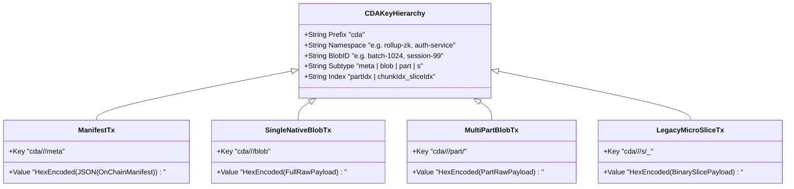
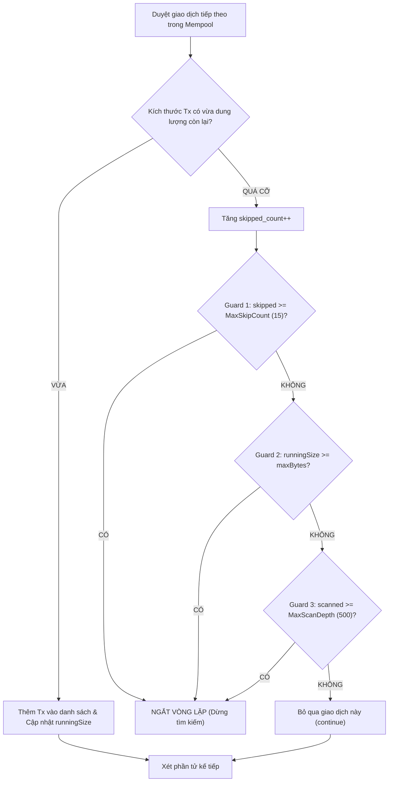
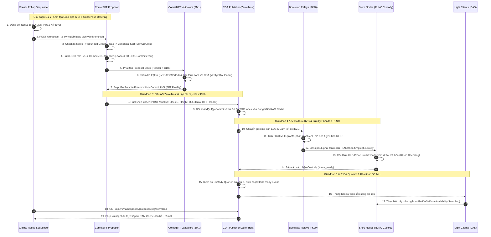

# Đặc Tả Kiến Trúc Phân Vùng Dữ Liệu (Namespace) & Vòng Đời Giao Dịch Trong CDA Network

Tài liệu này đặc tả toàn diện kiến trúc kỹ thuật của hệ thống **Phân vùng Dữ liệu (Namespace Subsystem)** và **Vòng đời Giao dịch Toàn trình (End-to-End Transaction Lifecycle)** trong mạng lưới **CDA Network (High-Throughput Data Availability Layer)**. Nội dung bao gồm quy tắc định danh không gian dữ liệu, thuật toán sắp xếp giao dịch tất định trong lớp đồng thuận CometBFT, thuật toán tối ưu hóa đóng gói khối Bounded Greedy Reaping, cấu trúc chỉ mục Table of Contents (TOC) tại Publisher Node, và các cơ chế truy xuất dữ liệu thông lượng cao.

---

## 1. Tổng Quan Kiến Trúc (Architecture Overview)

### 1.1. Bối cảnh & Mục Tiêu Thiết Kế
Trong kiến trúc Modular Blockchain, **CDA Network** đóng vai trò là lớp sẵn sàng dữ liệu (Data Availability - DA) độc lập, cung cấp bằng chứng toán học về sự tồn tại và tính hợp lệ của dữ liệu giao dịch cho nhiều Layer-2 Rollups và ứng dụng phi tập trung (dApps) vận hành đồng thời.

Để đảm bảo khả năng mở rộng quy mô đa người dùng (Multi-Tenancy) và duy trì hiệu năng cao, phân hệ Namespace và quy trình xử lý giao dịch được thiết kế thỏa mãn 4 tiêu chuẩn cốt lõi:
1. **Phân lập Không Gian Dữ Liệu (Namespace Isolation)**: Dữ liệu của từng dApp hoặc Rollup được phân bổ vào các không gian logic riêng biệt, cho phép các node mạng truy vấn có chọn lọc mà không cần tải hay lưu trữ toàn bộ khối.
2. **Tính Tất Định Mật Mã Học (Cryptographic Determinism)**: Thứ tự sắp xếp giao dịch trong khối được chuẩn hóa tất định ngay tại tầng đồng thuận, đảm bảo tính bất biến của ma trận dữ liệu gốc ODS ($K \times K$), ma trận mở rộng EDS ($2K \times 2K$) và các cam kết mật mã KZG (`CommitsRoot`, `ColumnComm`, `Coeffs`).
3. **Tối Ưu Hóa Không Gian Khối & Chống Nghẽn (Anti-HoL Bounded Packing)**: Cơ chế gom giao dịch tại Mempool ngăn chặn hiện tượng nghẽn đầu hàng (Head-of-Line Blocking) khi xuất hiện các transaction dữ liệu lớn, đồng thời giới hạn nghiêm ngặt thời gian tìm kiếm để bảo vệ tiến trình đồng thuận BFT.
4. **Truy Xuất Phi Trạng Thái Đạt Độ Trễ Dưới Một Giây (Sub-Second Stateless Retrieval)**: Cho phép client khôi phục nguyên trạng tệp tin nhị phân dựa trên bản ghi Head Manifest trên chuỗi thông qua bộ đệm Fast Path tại Publisher Node với độ trễ phản hồi mức mili-giây.

### 1.2. Mô Hình Phân Tầng Thực Thể (System Entities & Responsibilities)

```
┌────────────────────────────────────────────────────────────────────────┐
│                        CLIENT / ROLLUP LAYER                           │
│  - Phân mảnh dữ liệu nhị phân (Native Blob / Multi-Part / Slices)      │
│  - Nộp giao dịch qua CometBFT RPC: POST /broadcast_tx_sync             │
└───────────────────────────────────┬────────────────────────────────────┘
                                    │ HTTP / JSON-RPC
                                    ▼
┌────────────────────────────────────────────────────────────────────────┐
│                   COMETBFT BFT CONSENSUS LAYER                         │
│  - Mempool: Kiểm tra cú pháp (CheckTx) & Bounded Greedy Reap           │
│  - Proposer: Sắp xếp chuẩn tắc (SortCDATxs) -> Dàn phẳng ma trận ODS   │
│  - Engine CDA: Mã hóa 2D RS EDS -> BLS12-381 KZG Commitments           │
│  - Validators: Thẩm định thứ tự (IsCDATxsSorted) -> BFT Finality (2/3+)│
└───────────────────────────────────┬────────────────────────────────────┘
                                    │ PublisherPusher (POST /publish)
                                    ▼
┌────────────────────────────────────────────────────────────────────────┐
│                   CDA PUBLISHER NODE (ZERO-TRUST)                      │
│  - Đối soát độc lập BFT Header & CommitsRoot                           │
│  - Lập chỉ mục Block TOC & Phân mục Namespace vào BadgerDB             │
│  - Phục vụ API Fast Path (GET /api/v1/namespaces/.../download)         │
└──────────────────┬─────────────────────────────────┬───────────────────┘
                   │                                 │
                   │ Lan truyền EDS Columns          │ GossipSub Event
                   ▼                                 ▼
┌──────────────────────────────────────┐  ┌──────────────────────────────┐
│  BOOTSTRAP & STORE NODES (CUSTODY)   │  │   LIGHT CLIENTS (AUTO-DAS)   │
│  - FK20 Multi-proofs & RLNC pieces   │  │   - Lấy mẫu ngẫu nhiên DAS   │
│  - Phân tán Custody theo cột         │  │   - Xác thực KZG Range Proof │
└──────────────────────────────────────┘  └──────────────────────────────┘
```

---

## 2. Đặc Tả Phân Hệ Namespace & Định Dạng Khóa (Namespace Key Schema)

### 2.1. Cấu Trúc Định Danh Không Gian Dữ Liệu
Mỗi đối tượng dữ liệu trong CDA Network được định danh thống nhất thông qua định dạng URI chuẩn:
$$\texttt{cda://<namespace>/<blob\_id>}$$

Nhằm đảm bảo tính tương thích với engine ABCI `kvstore` của CometBFT (yêu cầu giao dịch tuân thủ cấu trúc khóa-giá trị phân tách bằng dấu bằng `=`, không chứa ký tự hai chấm `:` trong nội dung thô), toàn bộ các giao dịch CDA được chuẩn hóa theo quy tắc phân cấp tiền tố:

```
cda/<namespace>/<blob_id>/<subtype>[/<index>] = <payload_value>
```



### 2.2. Phân Loại Giao Dịch Dữ Liệu (Transaction Types)

#### 2.2.1. Giao dịch On-Chain Head Manifest (`meta`)
- **Định dạng khóa**: `cda/<namespace>/<blob_id>/meta`
- **Giá trị**: Chuỗi ký tự Hex mã hóa cấu trúc JSON của `OnChainManifest`. Việc mã hóa Hex ngăn chặn lỗi phân tích cú pháp ký tự `:` trong engine `kvstore`.
- **Vai trò**: Lưu trữ metadata gốc của tệp tin, phục vụ việc tái tạo dữ liệu phi trạng thái (Stateless Reconstruction) mà không cần phụ thuộc vào cơ sở dữ liệu ngoài chuỗi.

#### 2.2.2. Giao dịch Native Blob Transaction (Khuyến nghị vận hành chuẩn)
Mô hình Native Blob loại bỏ hoàn toàn sự phân mảnh vi mô, đảm bảo tính liên tục của các ô dữ liệu (Contiguous ODS Cells) trên ma trận:
- **Single Native Blob (`blob`)**:
  - **Định dạng khóa**: `cda/<namespace>/<blob_id>/blob`
  - **Đặc điểm**: Đóng gói toàn bộ payload nhị phân của đối tượng trong một giao dịch duy nhất (phù hợp với các đối tượng có kích thước nằm trong giới hạn một khối, ví dụ dưới $500\text{ KB}$).
- **Multi-Part Blob (`part`)**:
  - **Định dạng khóa**: `cda/<namespace>/<blob_id>/part/<part_idx:03d>` (ví dụ: `part/000`, `part/001`).
  - **Đặc điểm**: Áp dụng cho các đối tượng lớn vượt quá dung lượng một khối. Dữ liệu được chia thành các phần lớn ($16\text{ KB} - 64\text{ KB}$ mỗi phần) thay vì hàng nghìn lát cắt siêu nhỏ.

#### 2.2.3. Giao dịch Micro-Slices (Tương thích kế thừa - Legacy Compatibility)
- **Định dạng khóa**: `cda/<namespace>/<blob_id>/s/<chunk_idx:03d>_<slice_idx:04d>`
- **Đặc điểm**: Dữ liệu được chia nhỏ thành các lát cắt $500\text{ bytes}$. Định dạng này được duy trì để đảm bảo tính tương thích ngược cho các dApp thế hệ cũ.

---

### 2.3. Cấu Trúc Dữ Liệu Lõi (Core Data Structures)

Được định nghĩa tại [`cda-publisher-node/internal/service/indexer.go`](file:///home/ubuntu/cda-network/cda-publisher-node/internal/service/indexer.go):

```go
// OnChainManifest đại diện cho bản ghi metadata của Blob được lưu trên chuỗi khối
type OnChainManifest struct {
	Version     int      `json:"version"`
	Namespace   string   `json:"namespace"`
	BlobID      string   `json:"blob_id"`
	Filename    string   `json:"filename"`
	TotalSize   int64    `json:"total_size"`
	SHA256      string   `json:"sha256"`
	TotalChunks int      `json:"total_chunks"`
	ChunkSize   int      `json:"chunk_size,omitempty"`
	SliceSize   int      `json:"slice_size"`
	TotalSlices int      `json:"total_slices"`
	CreatedAt   int64    `json:"created_at"`
}

// BlobMetadata ghi nhận trạng thái chỉ mục tổng hợp của Blob tại Publisher Node
type BlobMetadata struct {
	Namespace      string   `json:"namespace"`
	BlobID         string   `json:"blob_id"`
	Filename       string   `json:"filename,omitempty"`
	TotalSize      int64    `json:"total_size"`
	SHA256         string   `json:"sha256"`
	TotalChunks    int      `json:"total_chunks"`
	ChunkSize      int      `json:"chunk_size,omitempty"`
	SliceSize      int      `json:"slice_size"`
	TotalSlices    int      `json:"total_slices"`
	ReceivedSlices int      `json:"received_slices"`
	BlockHeights   []int64  `json:"block_heights"`
	Status         string   `json:"status"` // "UPLOADING", "READY"
	CreatedAt      int64    `json:"created_at"`
	UpdatedAt      int64    `json:"updated_at"`
}

// BlockTOC đại diện cho Mục lục cấu trúc chi tiết của một khối CDA
type BlockTOC struct {
	BlockID    string         `json:"block_id"`
	Height     int64          `json:"height"`
	Namespaces []string       `json:"namespaces"`
	TotalTxs   int            `json:"total_txs"`
	Txs        []BlockTOCItem `json:"txs"`
}

// BlockTOCItem ghi nhận tọa độ phân bổ ô dữ liệu của từng giao dịch trong ma trận ODS
type BlockTOCItem struct {
	TxHash     string `json:"tx_hash"`
	Key        string `json:"key"`
	Namespace  string `json:"namespace"`
	BlobID     string `json:"blob_id"`
	CellOffset int    `json:"cell_offset"`
	CellCount  int    `json:"cell_count"`
	DataSize   int    `json:"data_size"`
}
```

---

### 2.4. Kiến Trúc Lưu Trữ Mục Lục (TOC Storage & Indexing Architecture)

Lớp đồng thuận CometBFT giữ vai trò phi trạng thái đối với mục lục ứng dụng nhằm tối ưu hóa thông lượng đồng thuận. Việc xây dựng và duy trì chỉ mục khối được quản lý tập trung tại **CDA Publisher Node** thông qua cơ sở dữ liệu khóa-giá trị nhúng BadgerDB:

```mermaid
flowchart LR
    subgraph CometBFT
        Block["Khối Đồng Thuận Đã Chốt<br/>(Mảng giao dịch có thứ tự)"]
    end

    subgraph CDA Publisher Node (BadgerDB Indexing)
        Block -->|"PublisherPusher"| Parse["Bóc tách tiền tố cda/"]
        Parse --> IdxKey["idx_key_<Key> -> Height"]
        Parse --> DataKey["data_key_<Key> -> Key=Payload (RAM Cache)"]
        Parse --> TOCKey["toc_<BlockID> -> JSON(BlockTOC)"]
        Parse --> NSKey["ns_blobs_<Namespace> -> Set[BlobIDs]"]
        Parse --> MetaKey["ns_blob_<Namespace>_<BlobID> -> JSON(BlobMetadata)"]
    end

    subgraph Client API Endpoints
        TOCKey --> API1["GET /api/v1/toc/:height"]
        NSKey --> API2["GET /api/v1/namespaces/:ns/blobs"]
        MetaKey --> API2
        DataKey --> API3["GET /api/v1/namespaces/:ns/blobs/:id/download"]
    end
```

- **`toc_<blockID>`**: Lưu trữ bản ghi `BlockTOC` hoàn chỉnh của khối.
- **`ns_blobs_<namespace>`**: Tập hợp các `BlobID` thuộc về từng Namespace.
- **`ns_blob_<namespace>_<blobID>`**: Trạng thái metadata chi tiết và số lượng phần đã tích lũy.
- **`data_key_<key>`**: Bộ nhớ đệm RAM lưu trực tiếp payload dữ liệu để phục vụ truy xuất với độ trễ tối thiểu.

---

## 3. Cơ Chế Sắp Xếp Giao Dịch Tất Định (Canonical Transaction Ordering)

### 3.1. Tính Bất Biến Của Ma Trận ODS & Hệ Quả Mật Mã Học
Trong hệ thống CDA Network, toàn bộ các giao dịch trong khối được dàn phẳng tuần tự vào các ô cell ($128\text{ bytes}$ hoặc $512\text{ bytes}$) của ma trận dữ liệu gốc ODS ($K \times K$):
$$\text{tx}[0] \to \text{cell}[0], \;\; \text{tx}[1] \to \text{cell}[1], \dots, \;\; \text{tx}[n] \to \text{cell}[n]$$

Nếu thứ tự giữa hai giao dịch bị hoán đổi:
1. Tọa độ byte trong ma trận ODS thay đổi cục bộ.
2. Quá trình nội suy đa thức Reed-Solomon 2D (Leopard RS) tạo ra ma trận mở rộng EDS ($2K \times 2K$) sai lệch hoàn toàn.
3. Các cam kết đa thức cột KZG (`ColumnComm`) và Merkle Root (`CommitsRoot`) thay đổi $100\%$.

Do đó, **thứ tự giao dịch là một thành phần bắt buộc của trạng thái mật mã học**. Quá trình sắp xếp giao dịch phải được thực thi mang tính tất định tuyệt đối ngay trong chu trình đồng thuận trước khi ký duyệt khối.

### 3.2. Thực Thi Phân Tầng Hai Lớp (Dual Consensus Enforcement)
Để đảm bảo trật tự giao dịch chuẩn mực không phụ thuộc vào trạng thái mempool ngẫu nhiên:

1. **Phía Proposer** ([`kvstore.go`](file:///home/ubuntu/cda-network/cometbft/abci/example/kvstore/kvstore.go#L164), [`execution.go`](file:///home/ubuntu/cda-network/cometbft/state/execution.go#L180)):
   - Trong giai đoạn `PrepareProposal` và trước khi gọi `BuildODSFromTxs`, Proposer bắt buộc phải chạy thuật toán sắp xếp chuẩn hóa:
     ```go
     types.SortCDATxs(txl)
     ```
2. **Phía Validators** ([`kvstore.go`](file:///home/ubuntu/cda-network/cometbft/abci/example/kvstore/kvstore.go#L182), [`cda_engine.go`](file:///home/ubuntu/cda-network/cometbft/state/cda_engine.go#L241)):
   - Trong giai đoạn `ProcessProposal` và hàm `VerifyCDAHeader`, Validator thẩm tra cấu trúc khối bằng hàm:
     ```go
     if !types.IsCDATxsSorted(block.Data.Txs) {
         return false, errors.New("invalid block transaction order: proposal rejected")
     }
     ```
   - Nếu phát hiện bất kỳ giao dịch nào sai lệch so với thứ tự quy chuẩn, Validator lập tức từ chối bỏ phiếu đề xuất khối (Proposal Rejection).

### 3.3. Phân Cấp Ưu Tiên Chuẩn Tắc (Canonical Sorting Hierarchy)

Thuật toán [`SortCDATxs`](file:///home/ubuntu/cda-network/cometbft/types/cda_tx_sort.go#L192) phân loại và sắp xếp giao dịch theo 4 tiêu chí thứ bậc nghiêm ngặt:

| Thứ Bậc | Tiêu Chí Phân Loại | Khóa Minh Họa | Độ Ưu Tiên | Quy Tắc So Sánh |
| :---: | :--- | :--- | :---: | :--- |
| **1** | **Category Danh Mục** | `val:...` (System)<br>`cda/...` (Namespace)<br>`key=val` (KV)<br>`raw` (Opaque) | 0<br>1<br>2<br>3 | Giao dịch hệ thống luôn đứng đầu khối, kế tiếp là dữ liệu CDA Namespace, sau cùng là KV thông thường. |
| **2** | **Namespace ID** | `cda/auth/...`<br>`cda/defi/...` | N/A | So sánh chuỗi ký tự theo bảng mã chữ cái (Lexicographical ascending). |
| **3** | **Blob ID** | `.../batch-01/...`<br>`.../batch-02/...` | N/A | So sánh chuỗi ký tự theo bảng mã chữ cái. |
| **4** | **Subtype & Index** | `meta` (Manifest)<br>`blob` (Single Blob)<br>`part/<idx>` (Parts)<br>`s/<chunk>_<slice>` | 0<br>1<br>2<br>3 | Manifest luôn đứng trước dữ liệu; Native Blob đứng trước Parts; các Part và Slice được sắp xếp theo giá trị số nguyên tăng dần. |

---

## 4. Thuật Toán Gom Khối Bounded Greedy Reaping (Block Space Optimization)

### 4.1. Vấn Đề Nghẽn Đầu Hàng (Head-of-Line Blocking)
Thuật toán gom giao dịch truyền thống của CometBFT ([`CListMempool.ReapMaxBytesMaxGas`](file:///home/ubuntu/cda-network/cometbft/mempool/clist_mempool.go#L525)) sử dụng cơ chế duyệt tuần tự FIFO nghiêm ngặt. Khi gặp một giao dịch có kích thước lớn hơn phần dung lượng còn lại của khối, thuật toán lập tức ngắt vòng lặp (`early return`).

*Hệ quả*: Nếu một giao dịch nhỏ ($25\%$ khối) đứng trước một giao dịch lớn ($100\%$ khối) và theo sau là một giao dịch vừa ($50\%$ khối), giao dịch vừa sẽ bị chặn đứng (Head-of-Line Blocking), làm lãng phí $75\%$ dung lượng khối đầu tiên và kéo dài thời gian hoàn tất từ 2 khối lên 3 khối.

### 4.2. Nguyên Lý Bounded Greedy Reaping
Để tối ưu hóa diện tích sử dụng của ma trận ODS mà không làm chậm nhịp đồng thuận BFT, hệ thống triển khai cơ chế **Bounded Greedy Reaping** tại [`cometbft/mempool/clist_mempool.go`](file:///home/ubuntu/cda-network/cometbft/mempool/clist_mempool.go#L535):
- Cho phép thuật toán tạm thời bỏ qua (`skip`) giao dịch quá cỡ để tiếp tục tìm kiếm các giao dịch nhỏ hơn phía sau nhằm lấp đầy tối đa dung lượng khối.
- Giao dịch bị bỏ qua vẫn được bảo lưu nguyên vẹn tại đầu hàng đợi Mempool để đưa vào khối kế tiếp.

### 4.3. Tam Tầng Chốt Chặn Bảo Vệ Tính Khả Dụng (3-Tier Bounding Guards)
Nhằm triệt tiêu nguy cơ vòng lặp tìm kiếm kéo dài hoặc tấn công cạn kiệt tài nguyên CPU (Mempool DoS), thuật toán áp dụng 3 điều kiện dừng nghiêm ngặt:



1. **Chốt chặn 1 (`MaxSkipCount = 15`)**: Giới hạn tối đa 15 giao dịch quá cỡ được phép bỏ qua. Khi vượt ngưỡng này, thuật toán kết luận danh sách phía sau chủ yếu là dữ liệu lớn và dừng quét ngay lập tức.
2. **Chốt chặn 2 (`Zero Remaining Check`)**: Khi `runningSize >= maxBytes`, không gian khối đã cạn kiệt, thuật toán ngắt ngay mà không tốn chi phí skip.
3. **Chốt chặn 3 (`MaxScanDepth = 500`)**: Giới hạn độ sâu quét tối đa 500 phần tử trong hàng đợi Mempool cho mỗi chu kỳ đề xuất khối.

### 4.4. Phân Tích Độ Phức Tạp Thuật Toán
- **Thuật toán FIFO cũ**: Độ phức tạp $\mathcal{O}(1)$ khi ngắt sớm, nhưng hiệu suất sử dụng khối kém ($25\% - 50\%$).
- **Thuật toán Knapsack không giới hạn**: Độ phức tạp $\mathcal{O}(N)$ với $N$ là tổng số phần tử trong Mempool (lên tới $50.000$ txs), dẫn đến nguy cơ quá thời gian đề xuất (`TimeoutPropose`).
- **Thuật toán Bounded Greedy**: Đảm bảo độ phức tạp thời gian giới hạn nghiêm ngặt ở $\mathcal{O}(m + k)$, trong đó $m$ là số giao dịch được chọn và $k \le 15$ là ngân sách bỏ qua tối đa. Thời gian thực thi đo được trong thực nghiệm duy trì ổn định dưới $0.05\text{ ms}$.

---

## 5. Đặc Tả Vòng Đời Giao Dịch Toàn Trình (End-to-End Protocol Lifecycle)



### 5.1. Mô Tả Chi Tiết Từng Giai Đoạn

- **Giai đoạn 1 (Client Ingestion)**: Client phân loại dữ liệu theo Namespace và định dạng thành Single Native Blob hoặc Multi-Part Blob. Tạo bản ghi Head Manifest đi kèm để neo giữ mã băm SHA-256 toàn vẹn.
- **Giai đoạn 2 (Consensus & Ordering)**: Giao dịch được thẩm định qua `CheckTx`. Khi tạo khối, Proposer áp dụng Bounded Greedy Reaping để gom khối, sắp xếp theo `SortCDATxs`, xây dựng ma trận ODS và mở rộng thành EDS thông qua thuật toán Leopard Reed-Solomon. Tính toán $2K$ cam kết cột KZG và Merkle Root `CommitsRoot` nhúng vào Block Header. Validator xác thực trật tự và cam kết trước khi chốt đồng thuận BFT.
- **Giai đoạn 3 (Zero-Trust Dissemination)**: Sau khi khối được commit, CometBFT chuyển khối sang Publisher Node qua kênh `PublisherPusher`. Publisher thực hiện đối soát lại độc lập giá trị `CommitsRoot`, sau đó bóc tách các khóa tiền tố `cda/` để lập chỉ mục `BlockTOC` và ghi dữ liệu nhị phân vào bộ đệm RAM BadgerDB.
- **Giai đoạn 4 (KZG Proving & RLNC Encoding)**: Tại tầng Bootstrap Relays, thuật toán FK20 được áp dụng để sinh đồng loạt bằng chứng mở KZG cho tất cả các ô trong ma trận EDS. Mỗi ô cell được chia thành $k_{\text{piece}} = 4$ mảnh và mã hóa tuyến tính ngẫu nhiên (RLNC).
- **Giai đoạn 5 (Distributed Custody Storage)**: Các Store Node tiếp nhận mảnh RLNC qua LibP2P GossipSub, thẩm tra tính hợp lệ qua KZG Pairing Check, lưu trữ vào cơ sở dữ liệu cục bộ và thực hiện tái mã hóa (Recoding) để phát tán chéo tăng cường khả năng chịu lỗi.
- **Giai đoạn 6 (DA Quorum & Auto-DAS)**: Khi nhận đủ xác nhận lưu ký an toàn từ mạng lưới Store Node, Publisher kích hoạt sự kiện `BlockReady`. Các Light Clients bắt đầu tiến hành lấy mẫu ngẫu nhiên (DAS) để thẩm định tính sẵn sàng dữ liệu với độ tin cậy toán học $1 - 2^{-S}$.
- **Giai đoạn 7 (High-Throughput Retrieval)**: Client truy xuất dữ liệu thông qua REST API của Publisher. Hệ thống đọc trực tiếp từ bộ nhớ đệm RAM BadgerDB (Fast Path), kiểm tra đối soát SHA-256 và truyền dữ liệu theo luồng (Streaming) về client.

---

## 6. Đặc Tả Giao Diện Lập Trình (API Specification & Data Schemas)

### 6.1. Truy Vấn Danh Mục Blobs Trong Namespace
- **Endpoint**: `GET /api/v1/namespaces/{namespace}/blobs`
- **Mô tả**: Trả về danh sách toàn bộ các đối tượng dữ liệu đã được ghi nhận trong Namespace.
- **Cấu trúc phản hồi**:
```json
{
  "status": "success",
  "namespace": "rollup-zk",
  "count": 1,
  "blobs": [
    {
      "namespace": "rollup-zk",
      "blob_id": "batch-1024",
      "filename": "state_diff_1024.bin",
      "total_size": 131072,
      "sha256": "4a5e1e...b8",
      "total_chunks": 1,
      "slice_size": 0,
      "total_slices": 1,
      "received_slices": 1,
      "status": "READY",
      "created_at": 1793261721
    }
  ]
}
```

### 6.2. Tải Dữ Liệu Luồng Trực Tiếp (Direct Streaming Fast Path)
- **Endpoint**: `GET /api/v1/namespaces/{namespace}/blobs/{blob_id}/download`
- **Mô tả**: Tải trực tiếp luồng nhị phân nguyên vẹn của đối tượng. Đọc trực tiếp từ BadgerDB RAM Cache với độ trễ phản hồi mức mili-giây.
- **HTTP Headers**:
  - `Content-Type: application/octet-stream`
  - `Content-Disposition: attachment; filename="<filename>"`
  - `Content-Length: <total_size_bytes>`

### 6.3. Truy Vấn Mục Lục Cấu Trúc Khối (Block Table of Contents)
- **Endpoint**: `GET /api/v1/toc/{height}` hoặc `GET /block/{height}/toc`
- **Mô tả**: Cung cấp mục lục phân bổ ô dữ liệu của khối, danh sách các Namespace tham gia và tọa độ cell tương ứng trong ma trận ODS.
- **Cấu trúc phản hồi**:
```json
{
  "block_id": "block-2",
  "height": 2,
  "namespaces": ["auth-service", "defi-exchange", "gaming-nft", "zk-evm-rollup"],
  "total_txs": 10,
  "txs": [
    {
      "key": "val:validator_node_addr_2/100",
      "namespace": "system",
      "blob_id": "",
      "cell_offset": 0,
      "cell_count": 1,
      "data_size": 30
    },
    {
      "key": "cda/auth-service/session-h2/blob",
      "namespace": "auth-service",
      "blob_id": "session-h2",
      "cell_offset": 1,
      "cell_count": 97,
      "data_size": 12288
    },
    {
      "key": "cda/defi-exchange/orderbook-h2/meta",
      "namespace": "defi-exchange",
      "blob_id": "orderbook-h2",
      "cell_offset": 98,
      "cell_count": 1,
      "data_size": 46
    },
    {
      "key": "cda/defi-exchange/orderbook-h2/blob",
      "namespace": "defi-exchange",
      "blob_id": "orderbook-h2",
      "cell_offset": 99,
      "cell_count": 145,
      "data_size": 18432
    }
  ]
}
```

---

## 7. Đánh Giá Hiệu Năng & Kết Quả Thực Nghiệm (Empirical Benchmarks)

### 7.1. Hiệu Năng Truy Xuất Dữ Liệu Tệp Tin (1.2 MB Payload)

| Cơ Chế Truy Xuất | Phương Thức Xử Lý | Thời Gian Đáp Ứng | Thông Lượng Đo Được | Hệ Số Tăng Tốc | Tính Toàn Vẹn SHA-256 |
| :--- | :--- | :---: | :---: | :---: | :---: |
| **CometBFT RPC Baseline** | Truy vấn đơn lẻ qua RPC (32 luồng) | $22.500\text{ s}$ | $0.05\text{ MB/s}$ | $1.0\times$ (Gốc) | $100\%$ Khớp |
| **BadgerDB Single Query** | Truy vấn đơn lẻ qua bộ đệm cục bộ | $1.156\text{ s}$ | $1.04\text{ MB/s}$ | $19.4\times$ | $100\%$ Khớp |
| **Batch Query API** | `POST /tx/batch` (500 khóa / lượt) | $0.072\text{ s}$ | $16.77\text{ MB/s}$ | $312.5\times$ | $100\%$ Khớp |
| **Direct Streaming Fast Path** | `GET /download` (Đọc trực tiếp RAM) | **$0.021\text{ s}$** | **$57.38\text{ MB/s}$** | **$1.071\times$** | $100\%$ Khớp |

### 7.2. Kết Quả Kiểm Thử Tính Liên Tục Của Ô Dữ Liệu (ODS Contiguity Verification)
Trong bài kiểm thử tải cao đa khối liên tiếp ([`TestMultiBlockMultiNamespace_HeavyTrafficStructuralVerification`](file:///home/ubuntu/cda-network/cometbft/state/cda_integration_test.go#L603)), hệ thống tiếp nhận các giao dịch bị xáo trộn ngẫu nhiên từ nhiều tenant khác nhau trong Mempool. Kết quả trích xuất Block TOC thực tế chứng minh ma trận ODS ($K=32, 1024\text{ cells}$) đạt tính liên tục toán học tuyệt đối:

$$\text{Cell Ranges}: [0] \to [1 \dots 97] \to [98] \to [99 \dots 243] \to [244 \dots 324] \to [325] \to [326 \dots 454] \to [455 \dots 583] \to [584] \to [585]$$

- Toàn bộ các cell của từng đối tượng Native Blob và các phần tiếp theo của Multi-Part Blob nằm tiếp giáp hoàn toàn không có khe hở (Zero Fragmentation).
- Bounded Greedy Reaping duy trì tốc độ gom khối dưới $0.05\text{ ms}$, giữ vững nhịp đồng thuận $100\%$ an toàn.

---

## 8. Định Hướng Phát Triển (Future Roadmap)

1. **Phân Quyền Ghi Theo Namespace (Permissioned Namespace Ownership)**:
   - Tích hợp lớp chữ ký mật mã (Ed25519 hoặc Secp256k1) vào tiền tố giao dịch `cda/<ns>/...` để ngăn chặn hành vi giả mạo hoặc ghi đè trái phép không gian dữ liệu giữa các tenant độc lập.
2. **Bằng Chứng Phạm Vi Namespace (Namespace Range Proofs Cho Light Clients)**:
   - Khai thác tính liên tục của các ô dữ liệu ODS đã được gom cụm bởi thuật toán sắp xếp để trích xuất bằng chứng phạm vi mở KZG (Range Proof / Sub-commitments) hoặc tích hợp Cây Merkle Namespace (NMT). Điều này cho phép Light Client thẩm tra toàn bộ dữ liệu của một Namespace cụ thể với chi phí kiểm thử tiệm cận $\mathcal{O}(\log N)$.
